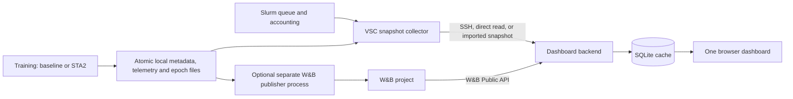

# Combined VSC training dashboard: repair and W&B integration plan

Prepared: 19 November 2026. Inspected checkout: `e961a4a`.

Status: **core implementation delivered locally on 19 November 2026**. See the implementation record below and the updated operating guide. The checklists retain the original target design; unchecked items are not claims of completed validation.

### Implementation record

- Implemented native baseline/STA2 collection, experiment/attempt metadata, optional separate W&B publisher/reader processes, independent source refresh, source precedence, legacy database backup/upgrade, comparison UI/CSV, optional configuration and monitored STA2 submission with dry run.
- Verified 24 standard-library monitoring tests, Python compilation, JavaScript syntax, HTTP routes/rejections and a real Chrome synthetic comparison. No live GPU jobs were submitted.
- Live W&B account upload/offline replay and VSC/DDP validation remain environment-dependent. The baseline trainer test skips without Torch; the STA2 training suite cannot import in this development shell because Torch is absent.
- Storage uses the existing JSON-record cache plus source observations rather than replacing it with all proposed normalized tables. One database is scoped to one cluster/project; switching identities is rejected. This preserves compatibility and prevents accidental cross-account merges.
- Operational limits in this implementation: 200 recent native experiments/cloud attempts per pass; 14 days of raw GPU samples (no hourly archival aggregates); epoch history is retained. Complete scientific histories are fetched through bounded cloud scans rather than persistent incremental cloud cursors. The operating guide documents these limits.
- The original full design remains useful for subsequent scaling work, including multiple profiles in one database, incremental/older-run discovery and richer resource/chart interactions. Do not mark those checkboxes complete based on the current implementation.

## 1. Intended outcome and implementation boundaries

Keep Training Observatory as the single browser interface. Combine VSC scheduler information, existing training files and optional Weights & Biases (W&B) experiment data behind the Python backend. Show queue status, training progress, metrics, logs, configuration and comparisons together.

The dashboard must work with W&B disabled, disconnected SSH, historical runs and offline snapshots. Each view must identify the source and age of its data. A disconnected source must not erase previously collected results or turn an old observation into a fresh one.

Scope for the first complete implementation:

- Repair the current collector, refresh feedback, data retention and status presentation.
- Support mean-pool, GRU and the current STA2 training/output/resume workflow.
- Add optional W&B publication and API ingestion, linked by explicit experiment and attempt identifiers.
- Add experiment comparison inside our dashboard, rather than requiring a second browser interface.
- Preserve existing CLI modes and import existing monitoring databases and snapshots.
- Supply realistic synthetic demos, automated checks, and updated Windows/VSC instructions.

Keep training algorithms, evaluation semantics, dataset splits, GPU allocations, learning rates, checkpoint formats and production resource requests unchanged. Monitoring is read-only with respect to Slurm: no submit/cancel buttons in this work. No public hosting, custom internet-facing API, shared team password, or self-hosted W&B server is required. The loopback dashboard continues to use SSH/VS Code forwarding for VSC access.

## 2. Evidence from the current implementation

### 2.1 Existing components

| File | Current responsibility | Relevant limitation |
|---|---|---|
| `scripts/dashboard.py` | HTTP server on `127.0.0.1:8790`, SQLite, source collection and ingestion | All responsibilities are in one file; one refresh lock and one general connection error; no W&B source |
| `monitoring/index.html` | Single-file HTML/CSS/JavaScript interface with job table and detail charts | One selected run, no comparison; re-renders detail every five seconds; limited state filters and refresh feedback |
| `scripts/monitor_snapshot.py` | Runs `sacct` and `squeue`, reads metadata, CSV history and log tails | Only discovers `results/runs/*/run.json`; does not discover STA2 output |
| `src/run_monitor.py` | Optional file heartbeat, training phase and GPU samples | Module-level monitor reads its directory at import time; no stable experiment/attempt contract; no STA2 integration |
| `scripts/submit_monitored.py` | Isolated mean-pool/GRU directories plus `run.json` before `sbatch` | Hard-coded P100 workflow; one job ID per run; no STA2 or resume model |
| `scripts/train_sta.py`, `src/sta_trainer.py` | Existing baseline instrumentation and atomic CSV history | No W&B; configuration does not yet supply complete comparison provenance |
| `scripts/train_sta2.py`, `src/sta2/training.py` | Distributed STA2 training, JSON history and checkpoints | No shared RunMonitor; rank-zero writes manifests/history independently of the dashboard |
| `slurm/sta2_full_h100.slurm` | Fresh STA2 directory or explicit resume into an existing directory | Can span multiple job IDs; current monitored submit wrapper cannot represent this |
| `tests/test_monitoring.py` | Six tests for collection, ingestion, submission and monitor failures | No W&B, STA2, HTTP, source conflict, migration or browser coverage |

Observed baseline: `python -m unittest discover -s tests -p test_monitoring.py -v` passes all six tests on local Python 3.13.5. This does not establish VSC connectivity, W&B connectivity, GPU correctness or visual correctness.

### 2.2 Concrete gaps to fix

1. **STA2 is invisible as an instrumented experiment.** Its files are under `results/sta2/<run>/history.json` and `run-manifest-JOBID.json`, while discovery only checks `results/runs/*/run.json`. A scheduler row may still appear, but without its training history.
2. **Source success and data freshness are conflated.** `ingest()` updates `last_success` even when the snapshot contains scheduler errors. Re-reading an old snapshot also needs to distinguish collection time from import time.
3. **Replacement can discard useful fields.** Run payloads are replaced wholesale. An unreadable history/config file becomes an empty value and can overwrite previously good information.
4. **Identity is too narrow.** Jobs are indexed by bare job ID and runs contain one job ID. This cannot safely model multiple profiles/clusters, resumed STA2 experiments or W&B projects.
5. **Refresh feedback is misleading.** The HTTP handler returns 202 even when the worker will skip a request because of cooldown or an existing refresh. The browser resets after two seconds regardless of the actual result and does not check the response status.
6. **Collection is only partly bounded.** Log reads are capped at 16,000 bytes and discovery at 200 run manifests, but CSV history is fully read before keeping the last 1,000 rows. Stored samples have no pruning policy; `/api/data` returns all stored detail/history/log payloads.
7. **Individual file errors are hidden.** JSON parse/read failures return `{}`; CSV failures are ignored. The interface cannot distinguish an empty history from a temporarily unreadable one.
8. **Scheduler completeness is not explicit.** `squeue` and `sacct` are merged without separate success/completeness metadata. There is no Submit/Start/End/TimeLimit data for identity and remaining-time displays.
9. **Status presentation is incomplete.** Terminal jobs can keep showing an old heartbeat warning. Filters omit several failure states. W&B status must never become a substitute for Slurm status.
10. **Charts and rendering need attention.** GPU charts use sample index and the maximum visible-device utilization; recall is displayed as a decimal without an explicit unit. Missing points are skipped rather than shown as gaps. Detail re-rendering can reset expanded configuration/log sections and scroll state.
11. **Submission uncertainty is not represented.** An unexpected successful `sbatch` response exits without recording a distinct uncertain outcome; an exception can leave `SUBMITTING`. A retry must not silently submit a duplicate job.

These are code observations and design gaps. Browser failures, network restrictions, cloud permissions and actual Slurm edge cases still need the validation described below.

## 3. Architecture and the role of the API key



Decisions:

- Keep the standard-library Python HTTP server and SQLite for this local tool. Avoid a framework migration unless a concrete requirement makes it necessary.
- Split backend responsibilities into small modules under `src/monitoring/`; preserve `scripts/dashboard.py` as the CLI entrypoint.
- Keep the remotely piped snapshot collector self-contained and standard-library-only. It currently runs via `python -` over SSH; new package imports must not accidentally break that deployment method.
- W&B API calls happen in a backend worker, never in browser JavaScript or HTTP request handlers. The browser reads cached normalized data.
- Training writes its existing artifacts first. Publish metrics from a separate optional process so SDK initialization, retries and network failures cannot block a DDP collective or change training outcomes.
- The publisher uses the W&B SDK to upload explicitly selected metrics/configuration. The backend uses the SDK Public API to read experiment data. Both are optional capabilities.
- Slurm access still uses the current VSC connection. A W&B key does not grant access to Slurm, VSC files or the SSH tunnel.
- Implement our own charts and comparisons. Do not depend on embedding the W&B website or scraping its UI.

Where the backend runs:

| Mode | How it works | Intended use |
|---|---|---|
| Laptop + SSH | Local database and HTTP server; one bounded remote collector call per scheduled refresh | Preferred when noninteractive SSH works |
| VSC + `--local-root` | Collector runs directly; HTTP server is reached through existing VS Code port forwarding | Preserve the currently documented workaround for laptop SSH failures |
| Snapshot | Import supplied JSON without contacting VSC | Demo, offline work and manually transferred snapshots |
| W&B only | Backend reads cloud metrics with scheduler collection disabled | Laptop without a VSC connection; scheduler/log data is missing or explicitly cached |
| Combined | Any live VSC mode plus optional W&B reading | Full intended dashboard |

W&B upload from a compute-node publisher can continue while the laptop is closed, provided the allocation is running and its outbound network access works. Live Slurm information in our dashboard still needs a running backend with VSC access. Do not promise an always-on website as part of this change.

## 4. Identity, resume and data contracts

### 4.1 Separate an experiment from an execution attempt

- `experiment_id`: persistent ID for a logical training run and its genuine checkpoint continuations.
- `attempt_id`: unique ID for one execution segment; new on each new Slurm job or requeue/restart execution.
- `profile_id`: non-secret configured source/account identifier to prevent cross-account merges.
- Scheduler identity: profile, cluster, job ID, and submit time when available; record array task IDs as strings. Preserve raw IDs and states.
- W&B identity: configured server, entity/team, project and W&B run ID. A bare W&B run ID is insufficient.
- `parent_attempt_id`, `resumed_from_epoch`, `resume_checkpoint` and `history_revision`: explicit continuation metadata.

Use **one W&B run per attempt**, grouped under `experiment_id`. This is a deliberate first-release choice: it avoids relying on cloud/offline resume behavior to reconcile metrics after an older checkpoint is restored. Our dashboard supplies the continuous experiment view. New attempts get new W&B IDs; restarting the publisher for the same attempt reuses its saved W&B identity after a compatibility check.

Distinguish the research name `sta2` from the baseline architecture name `gru`; do not derive identity from display names. Re-running the same model/configuration as a new experiment gets a new experiment ID. A fork from an older checkpoint gets a new experiment ID with a parent reference unless the operator explicitly requests a continuation.

For job-ID reuse, resolve job observations against submit time and linked attempt. If observations cannot be unambiguously attached, retain them as unresolved rather than merging unrelated jobs. A scheduler-only job can exist without an instrumented experiment. A W&B-only run can exist without a Slurm job. No fuzzy matching by model name or timestamp proximity.

### 4.2 New metadata alongside existing outputs

Preserve current artifact locations. Add monitoring metadata within each output directory:

```text
<output-dir>/monitoring/
    experiment.json                 # Stable experiment identity and schema version
    attempts/<attempt_id>/
        attempt.json                # Immutable identity plus atomically updated lifecycle fields
        telemetry.json              # Latest heartbeat, phase, progress and allocated GPU observations
        epochs.json                 # Atomic list of committed records owned by this attempt
        tracking-status.json        # Publisher status, sanitized error, cloud identity/link
        finish.json                 # Attempt end reason, when a clean writer can record it
        wandb/                      # SDK local spool; generated, never committed
```

`experiment.json` contains `schema_version`, experiment ID, task (`STA` initially), model family, creation time, provenance and comparison identity. `attempt.json` adds attempt ID, cluster/job identity, output path, start time, resume epoch/revision and optional W&B identity. Do not write credentials or a full environment dump.

The attempt ID must be established before workers start writing. For submitted jobs, create the pending attempt in the submit wrapper, then export its ID/directory. At runtime, verify Slurm identity and handle requeue restart count by creating/linking a new attempt segment. For direct training entrypoints, rank zero creates metadata and broadcasts the IDs through the existing distributed context. Nonzero ranks never race to create the same files or publisher.

Keep `history.csv`, STA2 `history.json`, configuration, manifests and checkpoints as training artifacts. The new epoch file is a small monitoring projection, written after the existing epoch history is committed. Failure to write that projection warns and leaves training intact; the collector can still read native history. Use one rank-zero writer and unique temporary names followed by atomic replacement.

### 4.3 Snapshot version 2

Add `schema_version: 2` with explicit `profile_id`, `cluster`, `collected_at`, `mode`, `sources`, `jobs`, `experiments`, `attempts`, `epoch_records`, `telemetry_samples` and `warnings`.

Each source section includes `status` (`ok`, `partial`, `error`, `disabled`), attempted/completed time, whether its enumeration is complete, sanitized errors and truncation information. Use separate source sections for queue, accounting and training files. An SSH transport failure is distinct from a successful remote call whose `sacct` command failed.

Each file-derived section reports whether it was read successfully, absent, invalid, truncated or unchanged. A malformed run must not discard good data for other runs. File modification time is discovery information, not proof that the training process is alive.

Support existing unversioned snapshots through an explicit v1 adapter. Convert CSV numeric strings safely; keep job IDs as strings; reject invalid roots/types, booleans masquerading as numbers, nonfinite values and unreasonable sizes. Unknown optional fields are ignored; unsupported future major schema versions produce an actionable error while retaining the cache.

### 4.4 Metric contract and units

| Canonical field | Existing source | W&B key to publish | Unit and display |
|---|---|---|---|
| `epoch` | Both trainers | `epoch` | Positive completed-epoch integer |
| `train_loss` | Both histories | `train/loss` | Raw scalar; label according to model loss definition |
| `validation_loss` | Both histories | `validation/loss` | Raw scalar |
| `action_mt5r` | Both histories | `validation/action_mt5r` | Fraction 0–1 in storage; percent in UI |
| `verb_mt5r`, `noun_mt5r` | Both histories | `validation/verb_mt5r`, `validation/noun_mt5r` | Same fraction/percent convention |
| `learning_rate` | STA2 history; add observation for baselines | `train/learning_rate` | Raw scalar, readable scientific notation |
| `train_seconds`, `validation_seconds` | STA2; add phase timing for baselines | `timing/train_seconds`, `timing/validation_seconds` | Seconds |
| `train_events_per_second`, `validation_events_per_second` | STA2; derive only with measured durations elsewhere | `throughput/train_events_per_second`, `throughput/validation_events_per_second` | Events/s; preserve documented count semantics |
| `best_action_mt5r`, `best_epoch` | History/telemetry; derive from valid committed epochs if needed | `best/action_mt5r`, `best/epoch` | Summary derived from the selected history revision |
| Event, usable, excluded and fallback counts | Existing training/validation metrics | Allowlisted corresponding `train/*` and `validation/*` keys | Integers, including true zeros |
| GPU utilization and device memory | Allocated-device telemetry | Optional later system-series publication | Percent; bytes internally, GiB in UI |
| `rank_peak_reserved_gpu_bytes` | STA2 history | `system/rank0_peak_reserved_gpu_bytes` | Rank-zero peak; never relabel as total node memory |

Missing metrics remain null/missing, not zero. Preserve native loss semantics: baseline and STA2 losses are not necessarily directly comparable. Store raw metric payloads plus normalized fields for future adapters. Define a metric contract version and evaluation protocol identifier.

Publish one coherent epoch record per completed epoch, including `epoch`, `attempt_id` and history revision. Use an explicit epoch metric as the chart axis; keep W&B's internal step separate. Initial publication is epoch-level; do not add per-batch cloud logging or gradient/model watching.

### 4.5 Merge rules and source authority

| Data | Authority and conflict behavior |
|---|---|
| Slurm state, pending reason, node, allocation and exit code | Latest valid scheduler observation for that job; queue supplies current active state, accounting supplies confirmed terminal history |
| W&B state | Separate tracking status only; never overrides a Slurm state |
| Experiment/attempt linkage | Explicit local IDs and matching published W&B metadata; contradictions become warnings requiring resolution |
| Epoch metrics | Valid native/monitoring file record wins for the same experiment/revision/epoch; W&B fills absent records/fields for explicitly linked attempts |
| Configuration/provenance | Versioned local manifest first, explicit matching W&B config second; retain conflicts rather than silently replacing values |
| Log tail | VSC file only in the first release; W&B absence cannot clear a cached tail |
| GPU series | Keep allocation/device/source identity; do not interleave different sampling definitions as one line |

Store both source observations when they disagree. A newer HTTP fetch time does not make an older cloud metric more authoritative. Apply successful sections transactionally; missing/unreadable sections keep the previous valid observations and acquire a freshness/error marker.

On resume from epoch N, a new attempt and history revision are created. Current experiment history inherits valid parent epochs through N; later parent records are superseded in the current projection and remain inspectable as historical observations. The new attempt owns epochs after N. Do not union stale cloud epochs from the abandoned branch back into the current result. Older out-of-order snapshots cannot roll back a newer revision. Do not infer a rollback just because a single snapshot is empty or truncated.

## 5. Storage, migration and retention

Use a versioned SQLite schema (`PRAGMA user_version`) with these logical tables:

| Table | Required contents / key |
|---|---|
| `profiles` | Profile ID, source configuration without secrets, cluster and W&B project identity |
| `experiments` | Experiment ID within profile, model/task, provenance, current history revision, summary |
| `attempts` | Attempt ID, experiment reference, scheduler identity, parent/resume fields, W&B identity, lifecycle |
| `job_observations` | Job identity, source (queue/accounting), observed time, raw/normalized state and resource fields |
| `metric_observations` | Experiment, attempt, revision, epoch, source, observed time, payload/content fingerprint |
| `telemetry_samples` | Attempt, source, device identity, sample time and measurements; idempotent unique key |
| `source_status` | Independent source attempt/success times, error code/message, completeness, cooldown and cursor |
| `run_details` | Versioned config, latest bounded log tail and field-level read status |
| `sync_requests` | Refresh request ID, requested sources, accepted/coalesced/running/completed outcome and times |

Implementation can use JSON columns for evolving payloads, with indexed identity, time, epoch and status columns. Avoid an ORM dependency. Keep schema ownership and projection logic in `src/monitoring/store.py` and `merge.py`; API handlers do not implement their own precedence rules.

Migration steps:

1. Open the old database read-only for inspection; identify the legacy `records` and `samples` tables.
2. Make a consistent SQLite backup using the backup API before migration; do not copy a live database file blindly.
3. Migrate inside a transaction into the versioned tables; retain legacy tables for the first release.
4. Assign legacy data a clearly named legacy profile; preserve raw payloads, terminal states, timestamps and samples. Keep ambiguous links unresolved.
5. Verify row counts, representative history values and repeatability. A second startup must not duplicate records.
6. On failure roll back and report the backup path. An unknown newer schema must not be modified.
7. Rollback means stopping the new server and pointing the old code at the pre-migration backup, not assuming the old server understands the new schema.

Default limits to implement and make configurable:

- List pages: 50 rows, maximum 200 per request; fetch details only for selected experiments/attempts.
- Per file read budget: 8 MiB for JSON/CSV history, 1 MiB for metadata/config; report truncation and retain last good data when a file exceeds budget. Never deserialize checkpoints.
- Discovery: at most 200 changed/recent experiments per pass, with a persistent cursor and an explicit older-run scan so older runs are not permanently invisible.
- Epoch records: preserve all normal training epochs; paginate history reads rather than dropping old scientific results.
- GPU samples: retain 14 days of high-resolution samples, then hourly min/mean/max aggregates for 90 days; expose aggregation and pruning counts. Epoch metrics/configuration remain until explicit cleanup.
- Log tail: 16,000 bytes per attempt, as today, with a truncated flag.
- Import payload: 32 MiB default ceiling; remote output reader must enforce a limit while reading rather than capture unlimited stdout and check afterwards.
- Serialize strict JSON (`allow_nan=False` after normalization). Read errors and corrupt records must not produce an invalid API response.

Use short transactions, a busy timeout and serialized writes. On the laptop, use a database on local disk. Do not enable WAL automatically for VSC shared storage; validate filesystem locking and choose supported journal/location behavior before changing it. If node-local storage is necessary in remote mode, document its lifetime and provide a consistent backup/export path so an ephemeral database is not mistaken for durable history.

## 6. VSC collector repair and training integration

### 6.1 Scheduler adapter

- Keep one `squeue` and one `sacct` command per scheduled VSC refresh, scoped to the configured user and cluster. Keep subprocess timeouts and no scheduler calls from browser polling.
- Add Submit/Start/End/TimeLimit and useful allocation fields through delimiter-safe supported formats. Verify actual wICE output before freezing parsers; represent unsupported fields as unknown.
- Preserve states such as `OUT_OF_MEMORY`, `TIMEOUT`, `CANCELLED`, `PREEMPTED`, `NODE_FAIL`, `BOOT_FAIL`, `REQUEUED`, `CONFIGURING`, `COMPLETING` and `SUSPENDED`. Store the raw value and a normalized category, including suffixed accounting states.
- Define precedence explicitly: a fresh queue observation of an active allocation supersedes lagging accounting; after the job leaves a successfully enumerated queue, use fresh terminal accounting. Missing from the queue is never success.
- If the queue is complete and the job disappears but accounting has no terminal record, show `UNKNOWN / awaiting accounting`. If collection fails, retain the last observed state with a stale marker.
- A failed `sacct` command must not prevent queue updates or metric collection, and vice versa. Requeue observations may reopen the active state of the same scheduler job and link a new execution attempt.
- Parse array IDs as strings and preserve task identity. Skip malformed lines with a counted warning, not silent global failure.
- Compute time remaining only from a valid current start/deadline/time limit and supported Slurm semantics. Otherwise show unknown. Queue waiting time is not training ETA.

### 6.2 Filesystem adapters

Provide three explicit readers:

1. Legacy monitored baseline: existing `run.json`, `logs/<model>/history.csv`, `configs/<model>.json`, `telemetry.json`.
2. Legacy STA2: `results/sta2/*/run-manifest-*.json`, `history.json`, plus explicitly configured/registered output roots.
3. Version-2 monitored experiment/attempt directories for both trainer families.

For legacy STA2, preserve all manifest job IDs. A filename job ID is evidence of an attempt, not enough to guess an arbitrary log path. Use known wrapper naming or an explicit registration file. Directories with incomplete identity remain visible as unlinked experiments. Do not collapse several independent runs because they share model/configuration.

Use deterministic bounded discovery, ignore temporary files, validate resolved paths against configured roots, and constrain log reads to explicitly allowed project log/output roots. Apply size/type validation before parsing. Avoid scanning videos, feature shards or checkpoint contents. Cache file fingerprints/mtime to avoid re-reading unchanged history, while supporting explicit rescan after a failed read.

### 6.3 Baseline and STA2 instrumentation

- Replace implicit module-import configuration with an explicit per-invocation monitor factory/context. Keep an inert default for existing callers until migration is complete.
- Establish identity before data/model initialization so long startup is visible. Wrap the entrypoint setup as well as the training loop; retain genuine training exceptions.
- Emit phases `initializing`, `training`, `validation`, `checkpointing`, `finished`, `failed`; include epoch/current progress where the trainer actually knows it.
- Add a separate progress timestamp/counter. A live heartbeat means the process exists, not that an epoch is making progress. Do not infer a hung job solely from slow startup/validation/checkpointing.
- Monitor only rank zero in STA2. Reuse existing aggregated epoch results after current reductions and checkpoint/history saves. Add no monitoring-only collectives or barriers.
- Record completion reason (`max_epochs`, `early_stopping`, `walltime_boundary`, `error`) separately from Slurm state. A clean walltime-boundary stop means the attempt ended and the experiment can be resumed; it does not mean the experiment reached its epoch target.
- Publish observation-only learning rate/timing for baselines. Keep RNG calls, optimizer/scheduler behavior, early stopping, best-checkpoint selection and resume checks unchanged.
- GPU telemetry remains device-level for allocated visible devices; preserve UUID, node and sample time. Validate visibility/mapping on the actual allocation, including UUID-style masks. Unsupported/MIG mapping gives unavailable with a reason, not fabricated GPU data.
- Existing running Python jobs cannot acquire this instrumentation retroactively. Add their readable native history through the legacy adapters; activate new instrumentation only on future starts/resumes.

### 6.4 Submission and attempt registration

Extend `scripts/submit_monitored.py` with an explicit job type: `baseline` or `sta2-full-h100`. Keep the existing `--model mean_pool|gru` invocation working. Use an allowlist of known scripts/arguments and a dry-run mode that creates no files/jobs.

For baseline, keep isolated output roots and current resources. For full STA2, allow the existing wrapper to accept a validated monitoring output override for a fresh run, while preserving its current default when called directly. Preserve `STA2_RESUME_RUN` semantics for genuine resume; use its experiment identity and append a new attempt. For direct `sbatch`, register at process startup, so the pending job is scheduler-only until then.

Write pending metadata before submission and update it atomically with parsable job/cluster identity. Model `SUBMISSION_FAILED` versus `SUBMISSION_UNKNOWN` distinctly. A transport error or ambiguous response may mean a job exists: record stdout/stderr safely and instruct the operator to inspect the queue; never auto-retry `sbatch`.

Pass only ID/path/configuration values through exported monitoring variables. Never put the API key in `#SBATCH`, command arguments, run manifests or printed environment diagnostics. Preserve all H100/P100 allocations, account values and existing Slurm environment cleanup.

## 7. W&B publication, reading and credential handling

### 7.1 Optional dependencies and configuration

Create `requirements-monitoring.txt` for a tested, pinned W&B SDK. Keep the base offline/dashboard/collector path runnable without it. Validate the pin with the repository's Python 3.11 training environments and selected dashboard Python; do not assume the locally tested 3.13 environment is identical to VSC.

Use a non-secret `configs/monitoring.example.json` and optional ignored local configuration file. Add a precise `.gitignore` entry for the local config. Avoid a dependency on dotenv; environment variables work directly and `.env` is not read implicitly.

Configuration includes source profile/cluster, allowed output roots, VSC collection interval, W&B enabled/entity/project/configured base URL, read interval, timeout/limits and training publisher mode (`disabled`, `online`, `offline`). CLI values override file values; document which environment variables the W&B SDK consumes. Credentials come only from a backend/publisher environment or the SDK's credential store.

Use `WANDB_API_KEY` for authentication where selected. Keep it out of command-line flags, browser storage, API responses, database config, screenshots and log messages. Configure each teammate with their own authorized account/key. Project access and key permissions are checked during setup; do not promise a read-only key type without verifying the account's supported permissions.

The backend must be able to start without a key: W&B source becomes disabled/unconfigured and other sources still work. No interactive login prompt inside background workers or a batch job. A configured cloud endpoint and credentials must agree; rely on the tested SDK configuration and returned run URLs rather than hard-coding legacy endpoint/link patterns. Upstream release notes currently describe endpoint changes, so recheck them during implementation [S3].

### 7.2 Publisher process

Add `scripts/wandb_publish.py`, using helpers from `src/monitoring/tracking.py`:

1. Rank-zero monitoring starts at most one publisher for the attempt, only when explicitly enabled. The worker is a separate process with no CUDA imports, no inherited distributed initialization and no monitoring barriers.
2. The worker reads committed `epochs.json` and allowlisted metadata from its attempt directory. It polls at a modest interval, e.g. 15 seconds; no network work occurs on the trainer thread.
3. Initialize W&B with saved attempt-specific ID, grouping by experiment ID, appropriate tags and explicit online/offline mode. Disable automatic console capture/code upload and model/gradient watching; upload no checkpoints, raw videos, feature arrays, secrets or arbitrary files.
4. Publish the complete committed epoch records not already represented in that attempt's cloud history. Include source revision and a content hash for reconciliation. Do not trust a local upload cursor as proof that the remote server durably accepted data.
5. On worker restart, reconcile saved state with remote history when online. For offline operation, keep SDK spool data and use the pinned version's supported resume/sync behavior only after testing it. If safe same-attempt spool recovery cannot be established, report pending recovery and retain files rather than silently creating an unrelated run.
6. Rate-limit retries with bounded backoff; write sanitized `tracking-status.json` atomically. An invalid key or worker crash changes tracking status, not training status. Missing SDK should produce one actionable warning.
7. On attempt end, request finalization through a local marker; allow a bounded shutdown grace (target five seconds) from the monitor supervisor. If necessary terminate the worker and retain spool/epoch data. Never hold an expensive allocation indefinitely waiting for cloud upload.
8. Provide a one-shot replay/sync command for a completed attempt. Upload pending epoch files without rerunning training. Replays must be idempotent in the dashboard even if the SDK transport cannot provide exactly-once delivery.

Online loss of connectivity should retain SDK spool and local epoch data and report a degraded state; do not repeatedly create new cloud runs or switch modes silently. Offline mode means metrics can be uploaded later, not that W&B offers live cloud data while disconnected.

This process separation is intentional reliability work. Direct SDK initialization in STA2 rank zero can otherwise stall other ranks at their next collective. Keep worker lifecycle implementation small and validate process cleanup on Windows and Linux.

### 7.3 Backend W&B reader

- Instantiate the Public API only in an optional bounded worker; prevent SDK credential prompts. Flush/refresh its run cache between polls as required by the tested SDK [S1].
- Scope run discovery to configured entity/project and our published project/task tags. Read explicit experiment/attempt IDs from config; never crawl every project in the account.
- Fetch summaries/config metadata first. Fetch metric history incrementally for linked visible/recent experiments; paginate project run discovery with a stored cursor.
- Use an unsampled history scan for authoritative epoch records; verify the exact API and sparse-field behavior against the pinned SDK. Do not treat sampled `history()` output as a complete training curve. Avoid requesting an intersection of optional sparse keys that would drop legitimate epoch rows.
- Track per-run high-water marks with a small overlap on subsequent scans; upsert by source record/attempt/epoch/revision and fingerprint. Account for duplicate rows and late uploads. A new attempt is a distinct scan stream.
- Interpret missing permissions, invalid key, timeout, not found and rate-limit responses separately. A cloud run disappearing does not delete its cached training history or local identity.
- Keep W&B status independent from queue/files/transport status. W&B may continue updating while VSC is disconnected; VSC may continue updating while W&B is unavailable.
- Bound each worker's wall-clock duration and received data, in addition to SDK request timeouts, so internal retries cannot monopolize refresh indefinitely. Redact credentials from errors and diagnostic payloads.

## 8. Backend refresh scheduling and HTTP API

### 8.1 Refresh policy

Defaults are project software choices, not claims of VSC-approved polling rates:

| Activity | Initial policy |
|---|---|
| Browser cache/status polling | Every 5 seconds while visible; pause/back off in hidden tabs |
| VSC snapshot | Manual by default, as today; recommended active-session interval 120 seconds |
| Manual VSC cooldown | At least 60 seconds; respect configured/site limits |
| W&B reader | 120 seconds for active attempts; terminal-run reconciliation every 15 minutes until settled |
| Publisher | Poll committed local epoch records every 15 seconds; send only new records |
| GPU heartbeat sampling | 30 seconds, preserving current order of magnitude |

Browser GET requests cause no upstream calls. Cache status reports the expected next refresh and source age. Manual refresh requests coalesce with work already running and respect per-source cooldown/backoff. One failed worker cannot hold the lock for another source. Use monotonic clocks for cooldown/deadlines and UTC timestamps for persisted observations; format human times using browser locale/timezone.

Initially schedule workers in the running dashboard process; do not install daemons, cron jobs or system services. Stop scheduler polling when the process exits. W&B-only mode does not invoke SSH at all.

### 8.2 Proposed API, version 2

| Endpoint | Response / behavior |
|---|---|
| `GET /api/status` | API/schema version, safe mode/config summary, independent source status and active refresh requests |
| `GET /api/experiments?state=&model=&q=&limit=&cursor=` | Lightweight experiment/attempt summaries with pagination and freshness; no full logs/history |
| `GET /api/jobs?limit=&cursor=` | Scheduler-only/unlinked jobs and scheduler observations |
| `GET /api/experiments/<id>` | Metadata, attempts, summary, provenance, conflicts and data availability |
| `GET /api/experiments/<id>/history?revision=&after_epoch=&limit=` | Canonical ordered epoch history, source information and continuation cursor |
| `GET /api/attempts/<id>/telemetry?from=&to=&resolution=` | Bounded device series with timestamps and aggregation metadata |
| `GET /api/attempts/<id>/log` | Bounded cached log tail, collected time and truncation/error status |
| `GET /api/compare?ids=<id1>,<id2>,...` | Up to 6 experiments, configuration differences, comparable metrics and compatibility warnings |
| `POST /api/refresh` | Validated JSON sources list; returns request ID and per-source accepted/coalesced/cooldown/disabled result |
| `GET /api/refresh/<request_id>` | Actual worker progress and outcome; browser follows this instead of a two-second timer |

Return 202 for accepted/coalesced asynchronous work, 200 for a valid request requiring no work, 400 for invalid input, 404 for unknown resources, and 429 with retry information when all requested work is in cooldown. In mixed cases return per-source outcomes; do not imply cloud/SSH success because a request was accepted.

Keep `/api/data` as a bounded deprecated v1 projection while transitioning the frontend and tests. Preserve the existing refresh custom header, validate browser Origin/Host for the loopback deployment, limit request bodies, and do not add permissive CORS. Serve local CSS/JS assets from an allowlist with correct content types. Resolve paths/IDs explicitly; no arbitrary-file endpoint.

## 9. Dashboard behavior and visual requirements

Keep the current dark visual direction and responsive layout; split the compressed page into readable `index.html`, `dashboard.css`, `dashboard.js` and small rendering/data modules if needed. Choose no new frontend framework for this scope. Existing canvas charts can be extended for six-series comparison; if a chart library materially reduces code, vendor a tested version locally with its license and document that choice before adding it.

### 9.1 Overview

- Header: source indicators for VSC connection, queue/accounting, training files and W&B, each with age/outcome. Distinguish demo, live, cached and snapshot mode.
- Summary cards: running/pending job attempts, completed attempts and attempts needing attention. Label scope and date filter; do not double-count one logical experiment with multiple attempts.
- Separate experiment rows from uninstrumented scheduler-only jobs. Show model, latest attempt/job, Slurm state, tracking status, completed/current epoch, latest/best Action MT5R and elapsed time.
- Search job/model/experiment; filter all normalized states, model family, date, source availability and active/history. Preserve filters and selection across polling.
- Per-source errors are scoped notices with a concrete recovery action; cached results remain usable. Empty, loading, error and no-match states are distinct.

### 9.2 Experiment detail

- Summary shows latest/best metric, selected best epoch, completed epoch/target, phase and completion reason.
- Attempt timeline shows each Slurm job, start/end, resume epoch, scheduler status and W&B tracking link/status. Users can choose current combined history or an individual attempt/revision.
- Tabs/sections: metrics, resources, configuration/provenance and logs. Preserve expanded sections, focus, selection and scroll while polling.
- Charts: train/validation loss, action/verb/noun MT5R, learning rate, phase duration/throughput when available, and allocated-device GPU utilization/memory.
- Use real epoch or timestamp axes; recall labeled percent (0–100), memory GiB, duration seconds/minutes. Tooltips show exact values/source/epoch/time. Draw gaps for missing samples; do not interpolate across long disconnects or different devices/attempts.
- Heartbeat age warnings apply to active attempts. For terminal attempts, label the last sample time without a perpetual live-heartbeat warning. Progress age is a separate observation and not a definitive hung-job detector.
- Log view offers explicit follow/pause and preserves position; data remains bounded and escaped. Output paths/config strings/errors must render as text. W&B links use trusted configured/SDK-returned URLs with safe external-link behavior.
- A training ETA may use the median of at least three completed epochs with the same execution/configuration and be labeled an estimate. Otherwise omit it. Show scheduler time remaining independently.

### 9.3 Compare view

- Select 2–6 experiments; compare by epoch with one consistent color per experiment and a clear metric selector. Allow toggling curves and latest versus best summary columns.
- Table: model, seed, learning rate, batch size, feature/backbone/protocol, split identity, completed epochs, best Action/Verb/Noun MT5R and selected epoch, duration and tracking availability.
- Best-epoch comparison uses the epoch selected by Action MT5R and reports the other metrics from that epoch; do not present three unrelated maxima as one model result.
- Reuse the intent of `src/sta2/artifacts.py` comparison identity: annotation/split hashes, evaluation/action-pair definition, metric version and full/smoke scope. Add missing provenance to new baseline runs. Mark legacy unknown identities explicitly.
- Different split/evaluation identities block an automatic shared ranking. Different model objectives warn against comparing loss values. Deliberate protocol variants can be shown side by side with labels; do not hide the difference or claim equivalence.
- Provide a CSV export of the displayed comparison and provenance, generated from cached data. No cloud call on export and no key in exported metadata.

### 9.4 Browser acceptance

Validate at approximately 1440, 1024 and 390 CSS pixels; keyboard selection, focus visibility, labeled controls and readable chart fallback tables are required. Browser network errors preserve the last rendered data and display an offline banner. Avoid rebuilding every DOM subtree on every five-second poll. No API keys or direct W&B/Slurm requests appear in browser network/storage inspection.

## 10. File-by-file implementation map

All paths below are repository-relative planned targets; existing training files retain their current responsibilities.

| File / group | Planned work |
|---|---|
| `src/monitoring/__init__.py` | Lightweight package; importing it does not import W&B or Torch |
| `src/monitoring/contracts.py` | Typed records, schema adapters, units, validation and metric mapping |
| `src/monitoring/identity.py` | Experiment/attempt IDs, legacy identity and explicit resume lineage |
| `src/monitoring/store.py` | Versioned SQLite schema, backup/migration, queries, retention and cursors |
| `src/monitoring/merge.py` | Source authority, history revision projection, conflict/freshness handling |
| `src/monitoring/sources.py` | SSH/direct/snapshot transport orchestration; keep remote collector self-contained |
| `src/monitoring/wandb_source.py` | Optional cloud Public API reader and normalization |
| `src/monitoring/tracking.py` | Publisher metadata/SDK mapping and replay helpers; imported only when needed |
| `src/monitoring/service.py` | Worker coordination, cooldown/backoff and refresh request status |
| `scripts/dashboard.py` | CLI/config, HTTP routes and startup/shutdown using the above modules |
| `scripts/monitor_snapshot.py` | Version-2 standalone collector, scheduler completeness and all output adapters |
| `src/run_monitor.py` | Explicit context lifecycle, atomic telemetry/epoch projection and bounded publisher supervision |
| `scripts/wandb_publish.py` | Optional isolated publisher, offline spool and one-shot replay/sync entrypoint |
| `scripts/submit_monitored.py` | Baseline compatibility, explicit STA2 type, dry run, attempts and uncertain submission state |
| `scripts/train_sta.py`, `src/sta_trainer.py` | Context/identity, committed epoch projection, observation-only timing and provenance |
| `scripts/train_sta2.py`, `src/sta2/training.py` | Rank-zero context/identity, phase/epoch hooks and resume/completion reason |
| `slurm/sta_train_p100.slurm`, `slurm/sta2_full_h100.slurm`, `slurm/sta2_train.slurm` | Minimal identity/output plumbing only; preserve resource/training/environment behavior |
| `monitoring/index.html`, `monitoring/dashboard.css`, `monitoring/dashboard.js` | Maintainable UI, source state, details, attempt timeline and comparisons |
| `configs/monitoring.example.json`, `.gitignore`, `requirements-monitoring.txt` | Non-secret example configuration, local ignores and tested optional SDK pin |
| `scripts/monitor_demo.py`, `tests/fixtures/monitoring/` | Deterministic synthetic multi-source/resume/failure fixtures; no real cloud/cluster IDs or secrets |
| `tests/test_monitoring*.py`, affected trainer/submission tests | Expand meaningful behavior coverage; keep standard-library monitoring checks usable without Torch/W&B |
| `docs/vsc_dashboard_stappenplan.md`, `README.md` | Updated setup, Windows/VSC commands, migration, offline behavior and troubleshooting |

## 11. Ordered implementation phases and exit checks

Do phases in dependency order. Each phase should leave offline demo/basic monitoring usable. Check off tasks with evidence when implementing; this document itself does not mark them complete.

### Phase 0 — Confirm environment and preserve a baseline

- [ ] Re-read applicable repository instructions, current diffs and this plan; inspect any changes since `e961a4a`.
- [ ] Capture a small existing database/snapshot fixture and baseline UI screenshots using synthetic data.
- [ ] Re-run the six existing monitoring tests and record the command/result.
- [ ] Select and test the W&B SDK pin with Python 3.11 and the selected dashboard environment; check current endpoint/auth/history/offline semantics [S1–S4].
- [ ] Record W&B entity/project/access mode and supported network path without writing a key to the repo.
- [ ] Verify read-only VSC access and actual scheduler formats. Establish whether compute-node outbound HTTPS and optional tracking uploads are supported by the site/account; a permitted network check is not a reason to submit a full GPU training job.

Exit: assumptions about installed versions, cloud endpoint and cluster behavior are either verified or explicitly marked for later manual validation. Offline implementation can continue without a live key/cluster.

### Phase 1 — Contracts, identity, storage and migration

- [ ] Add version-2 data types and legacy adapters with metric/unit validation.
- [ ] Add experiment/attempt/revision lineage and deterministic explicit links.
- [ ] Implement backup, transaction migration, source observations, projections and retention.
- [ ] Add merge tests for failures, stale/out-of-order snapshots, conflicts and duplicate observations.

Exit: a legacy fixture imports losslessly; duplicate imports do not duplicate samples; a missing or broken source cannot clear known history or advance its success timestamp.

### Phase 2 — Collector and baseline dashboard repairs

- [ ] Add independent scheduler/file completeness and errors.
- [ ] Add legacy STA2/native history discovery and bounded parsing.
- [ ] Preserve source timestamps and normalize job states/IDs.
- [ ] Split list/detail queries, expose source status and implement truthful refresh request outcomes.
- [ ] Keep legacy CLI/snapshot modes working while adding W&B-only source selection without SDK/network use yet.

Exit: a synthetic snapshot containing old baselines, STA2, an uninstrumented job and one malformed run shows the valid data together. Scheduler commands remain bounded to one each per allowed refresh.

### Phase 3 — Monitoring instrumentation and submission plumbing

- [ ] Introduce explicit monitor contexts and version-2 local artifacts.
- [ ] Add baseline and rank-zero STA2 committed epoch/progress hooks.
- [ ] Represent genuine resume/requeue attempts and history revision changes.
- [ ] Add monitored STA2 submission, direct-launch registration and safe dry run.
- [ ] Preserve best/last checkpoint behavior and all training/resource settings.

Exit: deterministic tiny trainer fixtures produce the same metric/checkpoint-selection results with monitoring disabled or enabled. A resume from an older checkpoint yields a new attempt and the correct canonical history without resurrecting abandoned epochs.

### Phase 4 — Optional W&B publisher

- [ ] Implement isolated worker lifecycle and allowlisted metadata/epoch publication.
- [ ] Add explicit online/offline/disabled modes and credential checks without prompts.
- [ ] Add cloud identity persistence, tracking status, replay and bounded shutdown.
- [ ] Verify failure cases with a fake SDK/worker before a small real W&B test.

Exit: absent SDK, invalid key, blocked network and a stalled child never change training success/failure or checkpoint choice. The same attempt is linked correctly on replay; spooled records remain recoverable.

### Phase 5 — W&B reader and combined data

- [ ] Implement project-scoped, paginated API discovery and complete epoch scans.
- [ ] Add per-source independent scheduling, caches, timeouts/backoff and history cursors.
- [ ] Merge local/cloud observations by explicit IDs and source rules.
- [ ] Support linked, cloud-only and local-only experiments and source outages.

Exit: with SSH disabled, cached Slurm states are visibly stale while W&B metrics can update. With W&B disabled, VSC/native metrics continue updating. Duplicate cloud/local rows produce one canonical epoch.

### Phase 6 — Unified UI and comparisons

- [ ] Refactor the page into readable local assets.
- [ ] Implement source indicators, filters, attempt timeline, chart units/gaps and correct refresh feedback.
- [ ] Implement comparison selection, configuration differences, compatibility checks and CSV export.
- [ ] Preserve user interaction state across polling; add accessible data tables for charts.
- [ ] Inspect the demo in a real browser at desktop/tablet/mobile widths.

Exit: a user can inspect job status, metrics, configuration and log tail and compare compatible experiments without opening another service. Browser traffic is entirely to our cached API, except an intentionally opened W&B link.

### Phase 7 — Documentation, validation and gradual rollout

- [ ] Update Dutch setup instructions plus README quickstart, including exact optional dependency/secret setup and cleanup commands.
- [ ] Document laptop/SSH, VS Code remote/forwarded, W&B-only and snapshot workflows.
- [ ] Document migrations/backups, legacy imports, offline replay, source troubleshooting and freshness semantics.
- [ ] Run the targeted tests below and inspect the final diff for accidental training/resource changes.
- [ ] Perform optional small cloud and VSC checks in the authorized environment; record what was actually verified.

Exit: offline acceptance is complete; any unavailable live checks are clearly named, with reproducible commands for the operator. Do not describe unverified VSC/cloud behavior as tested.

## 12. Verification matrix

### 12.1 Automated behavior tests

| Area | Required cases |
|---|---|
| Contracts | v1/v2 snapshots; invalid/missing types; numeric strings; zero versus missing; NaN/Infinity; future schema; oversized input |
| Migration | Existing JSON records/sample rows preserved; backup consistency; second startup idempotent; interrupted transaction; unknown newer DB rejected |
| Scheduler | Queue overrides lagging accounting; terminal accounting; accounting delay; command-specific failure; cancelled suffix; arrays; requeue; malformed row; cluster/job collision |
| Files | Baseline CSV and STA2 JSON; multiple manifests; temporary/malformed/missing/oversized file; good cache retained; bounded reads; paths outside allowed roots; explicit rescan |
| Identity/history | Multiple attempts per experiment; no name-based merge; same run ID in two W&B projects; replay idempotency; older-checkpoint resume; late/out-of-order old source observations |
| Training hooks | Disabled behavior unchanged; write failure isolation; setup/training exception preserved; only rank zero writes/publishes; monitor context can be reused in test invocations |
| Publisher | SDK absent; missing/invalid key; timeout; child crash/hang; no duplicate process; bounded finalization; offline spool preserved; replay after interrupted upload |
| Cloud reader | Paged runs/history; sparse optional fields; complete versus sampled history; API cache refresh; 401/403/404/429/timeouts; partial success; resumed attempt stream |
| Merge/status | W&B finished versus Slurm running; source conflicts; stale heartbeat on terminal job; missing job never means success; independent success timestamps and revision-aware best summaries |
| HTTP/scheduling | Source-independent cooldown; coalescing; request status; polling makes no upstream calls; limits/pagination; error status codes; escaped text; no credentials in payloads |
| Compare | Best Action-selected epoch; comparable identities; incompatible/unknown splits; smoke/full difference; objective loss warning; export includes provenance and true zero values |

Use fake clocks, subprocess outputs, SDK responses and tiny deterministic trainer fixtures. Do not require cloud accounts, network access or production datasets for routine tests. Exercise actual DDP rank/process behavior in a two-process smoke environment where supported; a mocked rank-zero test alone is insufficient to claim DDP integration is verified.

Suggested targeted commands after implementation (adjust names only if the final module layout differs):

```powershell
python -m unittest discover -s tests -p 'test_monitoring*.py' -v
python -m unittest discover -s tests -p 'test_sta_trainer.py' -v
python -m unittest discover -s tests -p 'test_train_sta.py' -v
python -m unittest discover -s tests/test_sta2 -p 'test_sta2_training.py' -v
python scripts/monitor_demo.py
```

Trainer tests need their existing Torch/numpy dependencies. Skips caused by missing dependencies are reported as skips, not a training pass. Run syntax checks for changed Slurm scripts in a Bash-capable environment. Broaden tests when the implementation affects shared training/evaluation behavior; do not launch real GPU training as an automatic test.

### 12.2 Browser scenarios

Use deterministic demo fixtures for: running baseline; pending STA2; completed experiment; failed attempt; resumed STA2 with two jobs; scheduler-only job; W&B-only run; malformed metric file; W&B failure with healthy VSC; VSC failure with healthy W&B; stale imported snapshot; incompatible comparison; empty database.

Check table/card counts, exact metric values and units, source age labels, log escaping, keyboard controls, chart gaps, selection/scroll persistence and compare export. Simulate a slow refresh and ensure the UI stays pending until the actual request completes. Resize without losing selection or creating clipped charts. Inspect browser console/network/storage for errors or credential leakage.

### 12.3 Small live validation, when available

1. Authenticate privately and verify only the intended W&B entity/project is accessible.
2. Publish 2–3 synthetic epochs to a clearly labeled disposable test project/run; read them back through our backend and compare exact values/counts. No dataset/model upload.
3. Stop/restart the reader/publisher, replay and verify no duplicate canonical epochs.
4. Produce offline records, sync using the pinned SDK's supported command, and verify recovery. Test one interrupted-finalization case.
5. Use read-only VSC collection against an existing job; verify state, job linkage and native history against its actual files/accounting.
6. Only if needed and authorized, use an existing tiny smoke workflow for the new trainer hooks and a two-rank check. Preserve production inputs/resources; no full-run submission just to test the dashboard.

## 13. Rollout, rollback and operational decisions

Rollout order: offline contracts/collector repair → native baseline/STA2 dashboard → local monitoring hooks → optional publisher → cloud reader → comparison UI → small live checks. W&B reading and publication have separate enable switches, so they can be disabled independently.

Before rollout, preserve the current dashboard database and any VSC-only code changes. No reset/clean of the remote checkout. Deploy new code through the existing reviewed Git/upload workflow. Existing running jobs continue with their current code; only native files can be newly collected from them.

If W&B misbehaves, disable the publisher/reader and continue using native files and the dashboard cache. If the dashboard migration fails, retain the source artifacts and use the consistent backup with the earlier server. Never roll back by deleting checkpoint/history directories or altering a running training job.

Deployment values still to fill in, without blocking local implementation:

- W&B account/entity/team, project, supported key permissions and project visibility.
- Tested SDK version, base URL and offline recovery behavior.
- VSC profile/SSH alias, approved collection interval and outbound connectivity from the intended publisher location.
- Actual legacy STA2 output/log locations and any output roots outside the checkout.
- Backend host preference and supported SQLite storage location for remote mode.

If online compute-node upload is unavailable, ship the full native combined dashboard plus offline/replay W&B support first. An optional publisher reading shared artifacts from an approved connected host can be considered later; it is not silently installed as a login-node daemon. Do not make connectivity an excuse to discard the native monitoring repairs.

## 14. Definition of done

- [ ] One dashboard shows scheduler-only, baseline, STA2 and explicitly linked W&B experiments.
- [ ] A logical experiment can span multiple attempts/jobs; its current history and best epoch respect checkpoint continuation/revision rules.
- [ ] Local/cloud failure and stale data are visible independently; no loss of previously good results.
- [ ] W&B is optional, secrets stay outside code/browser/artifacts, and training survives publisher failures.
- [ ] Queue state remains authoritative; cloud tracking status and experiment completion reason remain distinct.
- [ ] Existing CLI modes, v1 snapshot import and migration from the current database work.
- [ ] Comparisons use correct units, selected epochs and evaluation provenance, with incompatible results clearly handled.
- [ ] Refresh outcomes are accurate, upstream traffic is bounded, and the UI remains usable during outages/slow requests.
- [ ] Targeted automated checks and desktop/mobile browser review pass; live checks are reported with their actual limits.
- [ ] README and the Dutch operating guide describe setup, day-to-day use, offline recovery and rollback.

## 15. Primary references and version-sensitive follow-up

Implementation choices above primarily come from the inspected repository. The following upstream references establish the optional integration capabilities; recheck the selected SDK version before coding against them.

- **S1 — [W&B Public API](https://github.com/wandb/wandb/blob/main/wandb/apis/public/api.py):** authenticated run access and API cache behavior. [Run access/history overview](https://github.com/wandb/wandb/blob/main/wandb/apis/public/runs.py).
- **S2 — [W&B SDK quickstart](https://github.com/wandb/wandb):** SDK initialization, metric logging and private API-key setup.
- **S3 — [W&B releases](https://github.com/wandb/wandb/releases):** endpoint, offline resume and CLI behavior are version-sensitive. Do not copy older `wandb sync` flags without checking the pinned version.
- **S4 — [W&B offline command documentation](https://github.com/wandb/docs/blob/main/models/ref/cli/wandb-offline.mdx):** local recording and later upload. Resolve any difference between documentation and the pinned CLI by testing a disposable run.
- **S5 — [VSC job scheduler](https://docs.vscentrum.be/compute/jobs/index.html) and [VSC terminal access](https://docs.vscentrum.be/compute/terminal/index.html):** retain supported job/access workflows. These references do not establish outbound W&B access or permission for a persistent login-node service.

Implementation kickoff: read this document together with `docs/vsc_dashboard_stappenplan.md` and the current STA2 training guide, inspect the current checkout for intervening changes, then start Phase 0. Update this plan's checkboxes and validation evidence as implementation progresses.
