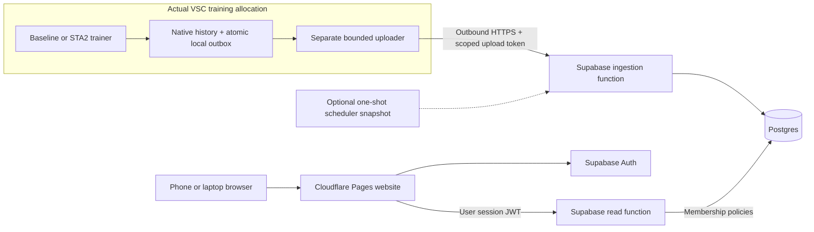

# Hosted Training Observatory: free prototype implementation plan

Prepared 19 November 2026 from the current working checkout, including the local dashboard changes already made in this chat.

Status: **plan only**. No cloud account, deployment, API key, paid service, VSC job or new background service is created by this document.

## 1. The outcome the user wants

Open a private dashboard from a phone or laptop using a normal HTTPS link. The user's PC can be switched off. No VS Code connection, SSH tunnel or VSC interactive session needs to stay open for viewing or receiving updates from an instrumented training job.

User preference confirmed: **free prototype; occasional provider pauses are acceptable**. This is not a requirement for guaranteed 24/7 availability. Hosting, API and database must survive browser closure and ordinary application redeployment, subject to the free provider's published limits.

Keep the existing local dashboard working as a fallback. W&B is not part of the required setup. Do not change models, data splits, numerical training behavior, checkpoint formats, Slurm resource requests or existing GPU jobs to deploy this dashboard.

### Success from the user's perspective

1. Sign in to one website on the phone.
2. See training attempts, progress, metrics, charts, comparisons and update times.
3. Close the laptop and end any interactive session; the phone still retrieves stored results.
4. A running training allocation continues uploading its own observations.
5. Later, completed runs remain available even though their jobs no longer run.
6. If the backend pauses or the network fails, training continues and observations remain available locally for replay.

## 2. Recommended free-first stack

| Component | Choice | Reason |
|---|---|---|
| Phone/laptop website | Cloudflare Pages static site, free plan | Hosts the existing HTML/CSS/JavaScript without a persistent Python process; supplies a provider hostname |
| Durable database | Supabase Postgres, free project | Stores experiments, epochs, observations and access membership independently of VSC |
| API | Short-lived Supabase Edge Functions | Receives authenticated uploads and serves authenticated read requests; no user-managed always-running server |
| Browser login | Supabase Auth, initially GitHub sign-in | Reuses managed authentication; avoids implementing passwords or operating an email service |
| Upload authentication | Our own scoped, revocable upload token | Gives the VSC uploader write-only access without giving it database administrator credentials |
| VSC uploader | Small standard-library Python process inside each training allocation | Makes outbound HTTPS requests; no inbound VSC access, W&B SDK or extra interactive session |
| Offline source of truth | Existing VSC history/checkpoint files plus a durable monitoring outbox | Allows recovery and preserves scientific results if the prototype is unavailable |

Use one Cloudflare Pages project and one Supabase project for the prototype. Choose an EU Supabase region at setup where available. Use the provider-generated website URL initially; do not require buying a domain. Pin frontend/Edge dependencies and deployment tools during implementation, after checking current supported versions.

The provider-specific details must be checked again before deployment. Current official documentation supports Pages asset uploads [S1], Supabase browser authentication and access policies [S3–S5], and short-lived Edge Functions [S6].

### Free-plan limits are part of the design

- Supabase can pause a free project after roughly a week of low activity. The user has accepted that tradeoff. The website should explain a paused/unreachable backend and how the owner resumes it; do not create fake keepalive traffic to avoid pausing [S2].
- Free quotas and backup availability must be checked during deployment. Do not promise unlimited retention, automatic backups or a permanently available endpoint [S2, S7].
- Cloudflare serves the static shell; Supabase holds private data. Public access to the HTML shell does not grant access to experiments.
- A phone may need a few seconds to reconnect after inactivity. Retries and clear status messages are required; an empty chart is not an acceptable substitute for an outage message.
- Do not automatically upgrade a plan, attach paid add-ons, buy a domain or enable uncapped billing. If quotas become insufficient, present measured usage and options.
- Do not use a trial database with an unnoticed short expiry. Render's free Postgres currently expires after 30 days, which is why it is not the proposed database [S8].

## 3. Architecture and trust boundaries



The website does not execute Slurm commands. The cloud holds no VSC SSH key, VSC password, MFA session, raw video, feature tensor or checkpoint. The API never accepts commands, Python code, shell fragments or file paths to execute.

The uploader lives for the duration of a real training allocation. It is not a new monitoring allocation, a login-node daemon or an interactive session. A later replay is an explicit short command from a permitted environment, not a requirement to keep the laptop running.

The cloud API is request-driven. Edge Function runtime limits are expected and do not terminate the dashboard after 12 hours: each API request finishes quickly and the database persists between requests. No polling loop, SSH session or uploader runs inside an Edge Function.

## 4. What can update without an interactive session

| Information | Source | Availability in the first release |
|---|---|---|
| Epoch loss, recall and selected best epoch | Trainer's committed history | Uploaded during training and replayable afterwards |
| Phase, progress counter and heartbeat | Rank-zero monitor | Uploaded during the actual job; visibly stale if uploads stop |
| Allocated GPU device measurements | Existing allocation-local telemetry | Available for instrumented jobs, with device/node identity |
| Job ID and known allocation details | Slurm environment within the job | Available when the batch job starts |
| Training completion/error | Trainer end event | Reported by the training process; distinct from scheduler completion |
| Batch script exit | Best-effort batch EXIT trap | A local exit report, not proof of final accounting state |
| Pending job created by our wrapper | Short submission event after `sbatch` | Can be uploaded from the submission shell before it closes |
| Full live queue and pending reasons | `squeue` on a permitted VSC host | Optional later collector; not promised by per-job uploads |
| Confirmed `COMPLETED`, `TIMEOUT`, `CANCELLED`, node failure, exit code | `sacct` observation | Only when a scheduler snapshot is supplied |
| Job killed before its final upload | No reliable final event | Show last observation and unknown/stale status; never infer success |

The first release provides complete **job-reported training monitoring**, not an invented live Slurm mirror. Full queue reconciliation is a separate optional capability and cannot be silently claimed complete.

### Optional scheduler reconciliation

Reuse `scripts/monitor_snapshot.py` in a one-shot command that uploads a bounded scheduler snapshot using a separate `scheduler:write` token. This can populate current queue/accounting information when the user runs it, without an ongoing session afterwards.

For automatic periodic queue updates, first establish a VSC-supported mechanism and allowed polling interval with site documentation/support. No login-node cron/daemon, permanent SSH connection, repeated tiny Slurm jobs or cloud-to-VSC SSH credentials are installed by default. A scheduled cloud task alone cannot read Slurm without an approved VSC-side source.

No scheduler reconciliation is needed for the phone to view stored metrics or receive updates from an instrumented active training job. The UI shows job-reported state, scheduler-observed state and their ages separately.

## 5. Current code to reuse and issues to resolve

| Current file | Reuse / adaptation |
|---|---|
| `monitoring/index.html`, `dashboard.css`, `dashboard.js` | Reuse the visual direction, charts, comparisons and CSV export; add login, a hosted data adapter and mobile improvements |
| `scripts/dashboard.py` | Keep local/SSH/snapshot modes. Do not expose its `ThreadingHTTPServer` as the production cloud server |
| `src/monitoring/store.py` | Reuse metric normalization and local compatibility semantics; it remains a local SQLite cache, not the cloud database implementation |
| `src/run_monitor.py` | Reuse atomic telemetry, rank-zero ownership, attempt metadata and completed-epoch projection; add a distinct API uploader option |
| `scripts/train_sta.py`, `src/sta_trainer.py` | Keep baseline epoch hooks and best-checkpoint selection |
| `scripts/train_sta2.py`, `src/sta2/training.py` | Keep native JSON history and rank-zero hooks; explicitly confirm resume lineage after the checkpoint validation succeeds |
| `scripts/submit_monitored.py` | Reuse preallocated attempt IDs, pending metadata, dry run and uncertain-submission handling; add optional outbound submission events |
| `scripts/monitor_snapshot.py` | Retain local native readers and optional scheduler snapshot generation; do not run it on every browser request |
| `scripts/wandb_publish.py`, `wandb_read.py` | Leave optional and disabled; the new API uploader does not depend on or wrap them |
| `tests/test_monitoring*.py` | Preserve existing regression coverage; add independent hosted/auth/outbox/ingestion tests |

Screenshot evidence from the user's deployed local dashboard: VSC collection succeeded, existing GRU histories appeared, the current STA2 job had no completed-epoch data yet, and one legacy STA2 result was unlinked. Preserve this honest handling of old/incomplete data. Do not fix linking by guessing model names or pretending missing heartbeats indicate job failure.

Deploy uploader and training hooks through the existing Git repository. Cloud publication requires updated hooks on future job starts or explicit backfill of existing histories.

## 6. Identity, event format and resume semantics

### 6.1 Stable identifiers

- `project_id`: hosted project/team; resolved from token or membership, not trusted from upload JSON.
- `source_profile_id`: configured VSC account/cluster source associated with an uploader credential.
- `experiment_id`: stable logical experiment, inherited only for an explicit checkpoint continuation.
- `attempt_id`: UUID for each execution segment, new on a new batch job, requeue/restart or retried training execution.
- `job_id`: string from Slurm, with cluster, submit time when known and restart count; array task IDs stay strings.
- `event_id`: UUID generated once and retained across every retry.
- `sequence`: increasing integer assigned by one local writer per attempt. Gaps are allowed after telemetry compaction; it is not an acknowledgement of every smaller number.
- `history_revision`: identifies the selected scientific training branch. Each confirmed continuation declares its parent attempt/revision and checkpoint epoch.

Use explicit identity links. A job ID alone, a display name or a close timestamp never merges two experiments. Importers assign stable legacy IDs and record their origin. Keep unlinked histories accessible.

### 6.2 Upload envelope

The first contract is `schema_version: 1`, independent of the local snapshot schema:

```json
{
  "schema_version": 1,
  "batch_id": "uuid-created-once-per-batch",
  "events": [
    {
      "event_id": "uuid-created-once-per-event",
      "experiment_id": "stable-experiment-uuid",
      "attempt_id": "execution-attempt-uuid",
      "sequence": 12,
      "kind": "epoch_committed",
      "observed_at": "2026-11-19T15:00:00Z",
      "payload": {
        "history_revision": "revision-uuid",
        "epoch": 1,
        "train_loss": 3.12,
        "validation_loss": 3.35,
        "action_mt5r": 0.0122,
        "verb_mt5r": 0.11,
        "noun_mt5r": 0.08
      }
    }
  ]
}
```

Use explicit schemas for `experiment_registered`, `attempt_submitted`, `submission_unknown`, `attempt_started`, `resume_confirmed`, `heartbeat`, `progress`, `epoch_committed`, `training_finished`, `training_failed`, `batch_exit_reported` and the separately scoped `scheduler_snapshot`.

Validation: UUIDs and bounded strings, finite numeric values, integer completed epochs/counts, fractions in 0–1 for recall, documented units, valid UTC timestamps and allowlisted payload fields. Boolean values are not numbers. Null/missing is distinct from zero. Reject unsupported schema versions and unknown event kinds. Do not accept arbitrary SQL or merge arbitrary dictionaries into database rows.

Timestamp rules: store server `received_at` separately from producer `observed_at`. Track transport reachability independently from measurement freshness. Replaying a three-day-old heartbeat today must not make the training appear live. Use sequence within an attempt to order producer events despite clock skew; reject or flag unreasonable future timestamps and contradictory identity claims.

### 6.3 Resume and immutable history

Only issue `resume_confirmed` after the existing trainer successfully validates/loads its checkpoint and knows the actual resumed epoch. The cloud does not inspect or load checkpoint files. The event identifies the parent attempt, inherited revision and last checkpoint epoch N.

The current experiment history inherits valid parent epochs through N. New epochs after N belong to the new branch. Parent epochs beyond N remain inspectable as superseded observations, not part of the selected comparison. Recompute the selected best Action MT5R and corresponding verb/noun results from that branch. Late uploads from an older attempt cannot make it current again.

Every attempt is retained in the timeline. Transport retry is not a new attempt; an actual process restart is. If a resume claim cannot be resolved, keep it unlinked with a diagnostic rather than selecting a branch silently. Changed model/split/protocol configuration creates a new experiment or an explicit fork, not an ordinary continuation.

## 7. API design and permissions

Deploy separate functions so uploader credentials and browser sessions cannot be confused:

| Function | Authentication | Role |
|---|---|---|
| `monitor-ingest` | Custom opaque upload token in `X-RND-Upload-Key` | Receive validated events within the token's project/profile/scopes |
| `monitor-read` | Supabase user session JWT plus project membership | Return bounded dashboard data for authorized viewers |
| `monitor-admin` | User JWT plus project owner membership | Issue/revoke scoped upload keys and manage prototype membership |

Logical routes under each function's provider URL:

| Route | Behavior |
|---|---|
| `POST monitor-ingest/v1/batches` | Transactionally commit a bounded event batch and projections; return per-event accepted/duplicate IDs |
| `POST monitor-ingest/v1/probe` | Authenticated connection test with no fabricated training data |
| `GET monitor-read/v1/overview` | One lightweight page of experiments, attempt summaries and source freshness |
| `GET monitor-read/v1/experiments/<id>` | Config/provenance, attempt timeline, summary and availability |
| `GET monitor-read/v1/experiments/<id>/epochs?revision=&cursor=&limit=` | Ordered canonical or requested-branch scientific epoch history |
| `GET monitor-read/v1/attempts/<id>/telemetry?from=&to=&resolution=` | Bounded timestamp/device samples |
| `GET monitor-read/v1/attempts/<id>/log` | Optional latest explicitly uploaded redacted tail; unavailable by default |
| `GET monitor-read/v1/compare?ids=...` | Up to six experiments, selected epoch, configuration/protocol compatibility |
| `POST monitor-admin/v1/upload-keys` | Issue a limited project/profile token; return plaintext only at creation |
| `DELETE monitor-admin/v1/upload-keys/<key_id>` | Revoke future writes; preserve collected scientific results |
| `GET monitor-read/v1/export?experiment_id=...` | Authenticated portable result/provenance export |

Paginate overview (50 rows default, 200 maximum) and epoch history (200 rows/page). Validate filters and bind all project scope on the server. Return no full history/log tail in the overview. Keep a versioned response adapter matching the current frontend's run/job terminology during transition.

Error contract: JSON with `code`, short sanitized `message`, `request_id`, and `retry_after_seconds` where relevant. Use 400/413/422 for invalid/oversized schema, 401 for invalid credentials, 403 for wrong scope/membership, 409 for contradictory immutable identities/content, 429 for rate limits, and 5xx for transient service failure. Acknowledge only after a durable database commit.

### Idempotency and transactions

The database enforces uniqueness on `(project_id, event_id)`. Repeating the same ID and content hash returns a duplicate acknowledgement. Reusing an ID with different content returns conflict. The client must not mutate an event after its ID is assigned.

Implement ingestion/projection in one bounded Postgres RPC transaction invoked by the Edge Function. Splitting it across several independent REST writes would allow partially acknowledged batches. Lock the relevant attempt/revision projection, enforce sequence/lineage rules, update metric/source projections and receipts, then commit. Invalid batches roll back together; no ambiguous partial success in v1.

Batch receipts are server-generated evidence of committed IDs. Do not acknowledge by a maximum sequence alone. The uploader removes/marks only explicitly acknowledged event files. An HTTP timeout after commit is expected: retrying the same IDs must be safe.

## 8. Authentication and privacy details

### Browser users

- Use Supabase Auth GitHub sign-in as the initial managed login; if the owner prefers email/password later, configure and test that flow explicitly rather than relying on unverified email delivery.
- Create an explicit `project_members` table tied to immutable Supabase user IDs. Successful GitHub login alone grants no experiment access.
- Bootstrap the owner through a documented admin/setup operation. Team users may authenticate but receive no data until added. No public self-enrollment into the research project.
- Enable row-level security and least-privilege grants on all tables/views exposed to user clients. Read functions pass the user's identity to user-scoped database access; they must not fetch all rows with an administrator client and filter them only in JavaScript.
- The browser may contain the Supabase project URL and **publishable** project key. That key is not an upload token or administrator secret [S4].
- Let the supported SDK manage user JWT refresh. Never store upload tokens or service-role keys in browser storage. Clear private in-memory results on sign-out. Do not cache authenticated API responses in the service worker.

### Upload token

Generate at least 32 random bytes, with a non-secret ID/prefix for lookup. Store only its cryptographic hash plus project/profile scope, permissions, created/expiry/revocation time and last-used metadata. Resolve project identity from the credential. Use constant-time digest comparison where comparison occurs in code.

Initial scope: `training:write` for one project and one configured VSC source. A scheduler collector needs a separate `scheduler:write` key. Neither can read experiments, delete history, manage members, create tokens or issue remote commands. Do not give VSC the Supabase secret/service-role key or a database password.

Store the plaintext VSC credential in an owner-readable local file, e.g. `~/.config/rd-dashboard/upload-key`, and pass only its path to the uploader. Do not place it in command arguments, committed configuration, batch output, deployment artifacts or scientific artifacts. The token is never printed on ordinary startup or error handling.

Use HTTPS with normal certificate validation. Reject cross-origin redirect destinations for uploader requests so a credential is never forwarded to an unexpected host. Handle redirects explicitly; do not retry by weakening TLS verification.

For the ingest function only, configure the provider JWT gate for custom service authentication as documented, then require our token in the handler before reading project data or calling the write RPC. Turning `verify_jwt` off does **not** make ingestion intentionally public: custom authentication is mandatory and tested. Keep browser/admin functions on user-JWT verification. Supabase's current key/header behavior is version-sensitive [S5].

### Data sent outside VSC

Upload only allowlisted metrics, non-secret configuration/provenance, job IDs, declared allocation metadata and telemetry. No raw videos, annotations containing sample text, tensors, checkpoints, environment dumps, VSC login credentials or absolute home/data paths by default. Display sanitized relative output labels rather than full mount paths.

Raw logs can contain secrets and personal file paths. Keep cloud log upload off by default. If enabled explicitly, redact known credential patterns, cap tails at 8 KiB and replace the latest tail rather than keeping every repeated copy. UI text remains escaped.

The static website is public code; research data remains authenticated. Use exact production/approved development origins for browser API CORS. CORS is not the authorization mechanism. Set a restrictive content security policy and serve bundled frontend dependencies locally.

## 9. Postgres data model

| Table | Key contents / important constraints |
|---|---|
| `monitor_projects` | Project UUID, label and retention settings |
| `project_members` | Unique project/user pair, owner/viewer role; used by RLS |
| `upload_credentials` | Token ID/hash, project/profile/scopes, expiry/revocation; never readable by viewers |
| `source_profiles` | Project, VSC account label/cluster; no SSH credentials |
| `experiments` | Stable ID, model/task/protocol, config/provenance, selected revision |
| `attempts` | Experiment reference, attempt UUID, Slurm identity, parent/restart/resume fields and producer state |
| `history_revisions` | Parent revision, checkpoint cutoff, owning attempt and activation order |
| `epoch_records` | Unique project/attempt/revision/epoch observation; scientific metrics and content hash |
| `telemetry_samples` | Attempt/device/sample identity and time; explicit units/source |
| `scheduler_observations` | Cluster/job/submit identity, source, raw/normalized scheduler state and observation time |
| `ingest_receipts` | Unique project/event ID, content hash, source sequence and durable commit time |
| `source_status` | Latest measured, transport and scheduler observation times independently |
| `latest_log_tails` | Optional redacted tail per attempt with collected time and truncation flag |

Use JSONB for bounded evolving payloads alongside indexed identity/time/epoch columns. Apply composite project foreign keys so rows cannot point into another project. Preserve UTC `timestamptz` values. Use views/RPCs for overview/best-epoch projections and make their RLS behavior explicit (`security invoker` for user-facing reads where supported).

Read roles have no raw mutation grants. Administrative/security-definer RPCs must have a fixed search path, explicit project checks and revoked default public execution; only the appropriate server/owner path can call them. Audit key issuance/revocation without recording secrets.

Migrations are versioned SQL under `supabase/migrations/`. Test on a local Postgres/Supabase instance and an empty disposable cloud project. Never point cloud code at a temporary SQLite file or a filesystem inside an Edge worker.

### Retention and quota control

Initial application budgets, to tune after measuring row/index sizes:

- Preserve scientific epoch records/configuration for at least the active project duration, with explicit exports before any later cleanup.
- Keep raw telemetry for 7 days, then hourly aggregates for 30 days. Show aggregation in the UI; retain no fabricated detail after pruning.
- Keep immutable receipt IDs/content hashes for the project duration so replay cannot resurrect conflicting events; raw transport bodies are not retained indefinitely.
- Retain optional latest log tails for 7 days; log upload stays opt-in.
- Payload maximum 256 KiB uncompressed, 50 events per batch, telemetry at most once per 30 seconds/device, uploader at most once per 60 seconds normally.
- Start with 10 batches/minute per credential and bounded project quotas; use persistent transactional rate buckets, not process-local Edge memory.
- Run bounded daily retention SQL using the provider's supported scheduling feature. This cloud maintenance is independent of VSC sessions. Publish database usage/retention counts to the owner view.
- Measure total database including indexes/receipts, function invocations and egress. Warn at configured 70%/85% budget thresholds; reduce optional telemetry/history polling before risking scientific result loss.

Capacity example, not a provider quota promise: a 72-hour run sampled every 30 seconds produces 8,640 telemetry time points. Four continuously active jobs produce about 11,520 time points/day before device expansion. A live overview polled every 30 seconds for four hours is 480 requests/day per visible phone. Batch requests and pause hidden-tab polling so free capacity is not wasted.

## 10. Durable VSC uploader

### Files and process ownership

Add an API mode to `RunMonitor`, independent of W&B. The trainer remains network-free. One rank-zero-owned child process reads atomic files and posts HTTPS; nonzero STA2 ranks create neither competing publishers nor extra distributed barriers.

```text
<output>/monitoring/attempts/<attempt-id>/
    attempt.json
    epochs.json
    finish.json
    upload-status.json
    api-outbox/
        00000001-<event-id>.json
        00000002-<event-id>.json
    api-acks.json
```

Outbox events are created once by one local writer using unique temporary names and atomic rename. Epoch events are appended only after native epoch history/checkpoint operations succeed according to the existing trainer contract. Monitoring I/O errors remain warnings and never change training outcomes.

Use a separate uploader script, `scripts/monitor_upload.py`, with reusable standard-library transport helpers. Do not add Supabase, W&B, Node or database clients to the GPU training environment. Worker start/shutdown and local file ownership must be tested on Linux and Windows.

### Delivery algorithm

1. Read non-secret endpoint configuration and the private key file. Validate HTTPS and expected host/path; reject credentials embedded in the URL.
2. Find unacknowledged immutable event files in source sequence order. Register experiment/attempt dependencies before their metrics; order a single batch accordingly.
3. Build a bounded batch. Persist its identity/content before sending so a retry can use the same immutable event IDs.
4. Send using short connection/request deadlines and a bounded worker operation. Default upload interval 60 seconds; epoch/end markers can wake the worker sooner.
5. After a durable success receipt, atomically record acknowledged IDs and compact only those event files. Crash between server commit and local acknowledgement is safe because retries are idempotent.
6. Retry timeout/5xx/429 with exponential backoff and jitter, capped at five minutes; respect provider `Retry-After` within a defined maximum. No tight loops while a project is paused.
7. For 401/403, stop network retries until credentials/configuration change or the process restarts; keep spooling and write an actionable sanitized status. For permanently invalid events, quarantine them with an error rather than blocking unrelated later valid events forever; never discard scientific records without a visible recovery report.
8. Keep the outbox below a configurable budget (initially 50 MiB). Coalesce old unsent heartbeats/telemetry first, preserving epoch/lifecycle events. Sequence gaps are valid. If scientific-event storage itself fails, retain native history and report that replay must reconstruct it.
9. On normal exit, permit a short bounded flush, then terminate the child if needed. Retain unsent events. The batch job must not wait indefinitely for a paused website.
10. Provide `--once`, `--dry-run`, `--probe` and explicit prior-attempt replay. Never require retraining to upload retained epoch results.

`upload-status.json` reports queued count, last successful upload, last measured event, next retry, mode and sanitized error code. The API does not need to ingest its own transport diagnostics repeatedly as training metrics.

### Integration with submission and batch lifecycle

- The monitored submit wrapper preallocates an attempt, writes local pending metadata, calls `sbatch` once and queues a submission event with returned identity. The cloud call is best effort and bounded; failure never retries `sbatch`.
- On an ambiguous `sbatch` response, upload `submission_unknown`; do not invent a job ID or re-submit automatically.
- Batch startup emits job/allocation identity and actual attempt/restart number. The Python trainer emits its own training lifecycle.
- Preserve any existing shell cleanup behavior while adding a best-effort exit-event helper around the complete batch workflow. P100 evaluation occurs after training, so Python success alone cannot mean the whole batch succeeded.
- SIGKILL, node failure and exhausted walltime can prevent final events. A trap is not guaranteed. Missing final status stays unknown until actual scheduler reconciliation supplies evidence.
- Secrets are configured through file paths, not `#SBATCH` directives or printed exported values. Publication is disabled when endpoint/key configuration is absent.

## 11. Phone interface changes

Retain one frontend with a data-source adapter: `LocalDataSource` uses current `/api/*` routes; `HostedDataSource` uses authenticated Edge APIs. Keep chart/normalization/comparison presentation shared so local fixes also benefit the phone.

Extend the local server's static-asset allowlist to serve any new adapter/auth modules needed by that shared frontend. Local mode must not initialize cloud authentication or require hosted credentials merely because the files are present.

Hosted flow:

1. Static page loads without research data.
2. Sign in with GitHub through Supabase Auth.
3. Verify project membership. Unauthorized users see an access message, never another project's rows.
4. Load one bounded overview; fetch details/epoch pages only for the selected experiment.
5. Show model, job-reported phase, observed scheduler state if any, completed epoch, best Action MT5R and last measurement time.
6. Open attempt timeline, recall/loss/resource charts, configuration, comparison and export as in the current dashboard.

Mobile requirements: readable at 390 CSS pixels, stacked cards, touch targets around 44 pixels, no compulsory horizontal page scrolling, expandable table columns, legends that wrap, and accessible exact-value tables for charts. Preserve selection/scroll/filter state during polling. Use a consistent color per experiment in comparisons.

Replace hosted `Sync sources` with `Refresh view`. It fetches saved cloud data; it cannot command an offline laptop or force VSC jobs to upload. Show `Last training measurement`, `Last upload received` and `Last scheduler observation` separately. A 30-second visible-tab poll is sufficient initially; pause while hidden and back off on errors.

Provider outage/pausing, browser offline, expired login and zero experiments are different states. Display last results already in memory with an explicit stale/offline banner, not an empty-state success screen. After sign-out, clear private results.

Add a web app manifest and icons so the user can add the website to the phone home screen. A service worker may cache versioned public static assets only; do not cache authenticated experiment responses or tokens. Native app-store packaging, push notifications and background phone polling are out of scope.

## 12. Import existing runs without disrupting training

Add `scripts/monitor_backfill.py` to read existing baseline CSV, STA2 JSON/manifests and optional legacy SQLite/snapshot exports. Reuse the current readers/normalizers where possible; extract shared contracts rather than copying contradictory logic into three places.

- Default `--dry-run` lists experiment/attempt mapping, record count, sanitized fields and unresolved links. Do not upload merely by scanning a directory.
- Preserve real existing IDs where available. Use a persistent local legacy-ID mapping for directories whose current identity is path-derived, so importing from a downloaded copy does not create a second experiment accidentally.
- Produce deterministic event IDs/content hashes for the same legacy scientific records, enabling repeatable imports.
- Import all scientific epochs in bounded batches; do not silently use only the 200 most recent discovery results.
- Do not inspect checkpoints or upload full paths/raw logs by default.
- Existing running Python jobs cannot gain upload hooks through a Git update. Their available histories can be imported, but future live publication starts on a new instrumented attempt/resume.
- Do not cancel/restart a healthy GPU job solely to enable the dashboard. A later one-shot backfill is sufficient for its historical results.
- One-shot scheduler snapshots can add authoritative observed state with explicit collection time. An imported week-old state is historical, not live.

Keep the current SQLite database and VSC outputs intact. Cloud migration is a copy with verification, not a destructive conversion. Compare experiment/epoch counts and representative metrics after import.

## 13. Planned implementation files

| File/group | Work |
|---|---|
| `supabase/config.toml` | Local project/function configuration and distinct auth modes |
| `supabase/migrations/*.sql` | Tables, constraints, RLS/grants, transactional ingestion/read RPCs and retention |
| `supabase/functions/_shared/contracts.ts` | Bounded event validation, error format and metric contract |
| `supabase/functions/_shared/auth.ts` | Token lookup/scoping, user membership, safe logging and origin handling |
| `supabase/functions/monitor-ingest/index.ts` | Probe/batch routes and transaction invocation |
| `supabase/functions/monitor-read/index.ts` | User-scoped overview/detail/history/compare/export routes |
| `supabase/functions/monitor-admin/index.ts` | Owner-only key creation/revocation and membership operations |
| `src/monitoring/api_contracts.py` | Python event schemas/normalization and cross-language fixtures |
| `src/monitoring/outbox.py` | Atomic event persistence, ack ledger, safe telemetry compaction and replay |
| `src/monitoring/api_transport.py` | Standard-library HTTPS transport, auth headers, limits/backoff and diagnostics |
| `scripts/monitor_upload.py` | Separate worker, one-shot replay and probe/dry-run commands |
| `src/run_monitor.py` | Optional API child lifecycle and event projection; W&B remains independent/disabled |
| `scripts/submit_monitored.py` | Pending/submission/unknown events with no duplicate submission |
| Trainer entrypoints and loops | Startup, committed epoch, actual resume, phase/progress/end observations only |
| Active baseline/STA2 Slurm wrappers | Minimal batch startup/end plumbing, preserving existing traps/resources |
| `scripts/monitor_backfill.py` | Native/snapshot/SQLite import with repeatable legacy identity and dry run |
| `monitoring/data-source.js`, `monitoring/auth.js` | Local/hosted adapters and managed login |
| Current HTML/JS/CSS | Hosted state/ages, mobile controls and public-shell offline behavior |
| `monitoring/manifest.webmanifest`, icons, optional service worker | Home-screen installation; public asset cache only |
| `package.json`, lockfile, frontend build config | Pinned Supabase browser dependency and deterministic static output; no new frontend framework required |
| `configs/monitoring-hosted.example.json` | Public frontend endpoints/project ID; no secrets |
| `configs/monitor-upload.example.json` | Non-secret API endpoint, credential-file path, interval and limits |
| `scripts/build_hosted.mjs` | Build frontend `dist/` using public configuration; deploy VSC scripts and hooks through Git |
| `tests/test_monitor_api*.py`, Edge/SQL tests, browser checks | Delivery, project isolation, migrations and phone acceptance |
| `docs/hosted_dashboard_setup.md`, README | One-time setup, deployment, upload configuration, pause/replay, export and rollback |

The hosted frontend package must contain only built web assets. The VSC bundle contains only required Python/hooks/config examples. Neither includes `.env`, private credentials, database dumps, node_modules, data, results or model weights. Verify archive manifests before delivery.

## 14. Ordered phases with concrete exit criteria

### Phase 0 — Freeze assumptions and verify feasibility

- [ ] Re-read current instructions, code, diffs, local-dashboard plan and this plan. Preserve existing uncommitted work and the functioning local deployment.
- [ ] Record free-first hosting preference. Check current free quotas, pausing, deployment/auth behavior and dependency versions against primary docs.
- [ ] Verify outbound DNS/TLS/HTTPS from an actual intended VSC compute environment to the target API host using an existing permitted allocation where possible. Successful laptop/login-node access alone does not prove compute-node access.
- [ ] Determine whether outgoing access/use is permitted. Do not bypass network restrictions or start an unapproved login-node bridge.
- [ ] Select a test fixture with baseline, STA2, resume, unlinked result and missing final status.

Exit: core uploader feasibility is verified or explicitly blocked. Local contract/database/frontend implementation can proceed without live credentials, but do not claim live phone updates if compute-node egress remains unavailable.

### Phase 1 — Contracts, outbox and native integration

- [ ] Specify language-neutral JSON schemas and shared valid/invalid golden fixtures.
- [ ] Implement stable IDs, immutable events, disk outbox, acknowledgement ledger and retry/compaction rules.
- [ ] Wire rank-zero native committed epochs/lifecycle/resume confirmation into outbox creation.
- [ ] Add the separate standard-library worker with probe/dry-run/once modes and bounded shutdown.

Exit: a simulated unreachable API cannot change training metrics/checkpoint selection; duplicated/replayed records retain the same IDs; interrupted local writes preserve a recoverable outbox.

### Phase 2 — Database and authenticated ingestion

- [ ] Implement migrations, composite scope constraints, RLS/grants and exact membership policy.
- [ ] Implement hashed/scoped/revocable credentials and the transactional ingest RPC.
- [ ] Implement Edge batch/probe handlers, request limits, durable receipts and rate limits.
- [ ] Exercise duplicates, rollback, conflicting event IDs, out-of-order events and checkpoint revisions.

Exit: committed batches are replay-safe; cross-project writes/reads and unprivileged direct table mutations are denied; API success means durable commit.

### Phase 3 — Read API and phone frontend

- [ ] Implement project-scoped overview/detail/epochs/telemetry/compare/export reads.
- [ ] Add Supabase managed login plus explicit owner/viewer membership.
- [ ] Add local/hosted adapters while preserving the existing local route behavior.
- [ ] Implement mobile presentation, correct freshness/status wording, login expiry/offline/backend-paused states and home-screen metadata.

Exit: synthetic results can be viewed and compared in a 390-pixel browser; unauthenticated/nonmember users cannot retrieve data; refreshing the page does not access VSC.

### Phase 4 — Submission, batch exit and historical import

- [ ] Add optional pending/start/end batch events and uncertain-submission handling.
- [ ] Preserve all training resources, existing traps, checkpoint/resume semantics and P100 post-training evaluation.
- [ ] Add one-shot backfill and scheduler-snapshot upload with separate scope.
- [ ] Package native uploader and frontend separately, with file-manifest/secret checks.

Exit: importing the same old run twice does not duplicate scientific results; no Slurm job is submitted by a dry run/import/probe; a killed job remains unconfirmed until authoritative reconciliation.

### Phase 5 — Prepare and deploy the free prototype

- [ ] Create one free Supabase project in the chosen region, apply migrations, set Edge secrets and deploy functions.
- [ ] Configure Supabase GitHub sign-in and exact frontend callback URLs. Bootstrap only the authorized owner/project membership.
- [ ] Build the static frontend with public configuration. Deploy through Cloudflare Pages Direct Upload (built folder or Wrangler CLI); use its provider URL initially.
- [ ] Restrict function browser origins to that deployed URL. Verify login and private data access from a phone.
- [ ] Generate one scoped upload key through the authenticated owner path and store it privately on VSC. No service-role key is sent there.

Deployment steps involve user-owned accounts and credentials; prepare tested code, artifact manifests and exact setup instructions first. Follow existing authorization/tool rules for actual account connection and publication. Do not ask for secrets in chat or incur charges.

Exit: synthetic test epochs round-trip through the deployed API and can be read only by the authorized phone user. The PC is not an infrastructure dependency.

### Phase 6 — Small live proof and outage recovery

- [ ] Use an existing suitable permitted test allocation, or an explicitly selected tiny smoke job if necessary; never launch full training just to test the dashboard.
- [ ] Publish a few finite epochs/heartbeats from the intended VSC environment and compare exact values with local files.
- [ ] End the interactive session and switch off/disconnect the laptop; verify phone access and continuing uploads from the still-running actual job.
- [ ] Interrupt network/API access, verify local spooling, then replay and confirm no duplicate canonical epochs.
- [ ] Test failed/absent final events, expired/revoked token and a controlled backend-unavailable scenario. Separately verify actual provider pause/restore when feasible.
- [ ] Import an existing GRU run and a STA2 history, keeping unresolved links honest.

Exit: the phone workflow and recovery are demonstrated with measured evidence. Unavailable live checks remain named; local mocks do not count as live verification.

### Phase 7 — Documentation, cleanup and handover

- [ ] Write concise daily-use instructions and full one-time setup/runbook.
- [ ] Record the website URL, public config, region, provider limits, backup/export process and how to resume a paused project.
- [ ] Explain source status semantics and the optional scheduler reconciliation limitation.
- [ ] Run final targeted tests and inspect the diff for accidental model/data/resource changes.
- [ ] Verify local fallback still starts with the existing command and no cloud credentials.

Exit: day-to-day use is opening the phone website; new instrumented jobs need only the endpoint/key-file configuration, not an interactive monitoring session.

## 15. Verification matrix

| Area | Required checks |
|---|---|
| Contract parity | Python/TypeScript agree on golden events, missing/zero values, numeric bounds, timestamps, Unicode and unsupported schema |
| Ingestion | Same event retried; timeout after commit; conflicting ID; mixed invalid batch rollback; foreign attempt/project; large/recursive/extra payload rejected |
| Outbox | Crash before/after rename; ack interruption; worker restart; disk limit; dropped/coalesced telemetry sequences; scientific records retained |
| Auth/access | Anonymous, signed-in nonmember, viewer, owner, expired/revoked token, wrong project/profile/scope; secret never in HTML/API errors/archives |
| Native training | Monitoring disabled/enabled produces identical checkpoint selection/metrics; only rank zero writes/uploads; worker stall cannot block DDP |
| Resume | Confirmed cutoff; superseded suffix; late parent uploads; new attempt identity; incompatible provenance/fork; recomputed best epoch |
| State truth | Training success versus batch evaluation failure; hard kill without final event; accounting contradicts local report; old replay not fresh heartbeat |
| Read API | Stable pagination, query filters, bounded comparison/export, RLS on tables/views/RPCs and no metadata leakage |
| Phone | 390/768/1440 widths, iOS Safari and Android Chrome where available, touch selection, exact-value fallback, preserved scroll, authentication return flow |
| Availability | Phone access with PC off; interactive session ended; API unavailable; project pause/restore; database survives frontend/function redeploy |
| Quotas | Four-job fixture; request/data-size estimates versus measured DB/index growth; hidden-tab polling pause; cleanup leaves epoch records intact |
| Migration | Repeatable old CSV/JSON/SQLite import, dry-run mapping, unlinked histories retained, representative scientific values/counts unchanged |

Routine tests are offline/local, using fake HTTP responses/clocks and tiny data. SQL/RLS tests require a real disposable local Postgres/Supabase instance; an in-memory Python mock is not proof of database authorization or transaction isolation. Keep cloud tests small and use synthetic project data.

## 16. Deployment and recovery runbook to deliver

The implementer must deliver exact checked commands, not placeholders presented as already-run setup. Proposed user workflow:

1. One-time: create provider projects, configure login, deploy prepared assets/API, store one upload key privately.
2. Set `RND_MONITOR_API_URL` and `RND_MONITOR_UPLOAD_KEY_FILE` through a non-secret local VSC configuration. Names and precedence are fixed in implementation/docs.
3. Submit training normally; the optional uploader runs inside its allocation.
4. Open the website on the phone; add it to the home screen if desired.
5. If uploads fail, training continues. Inspect sanitized local `upload-status.json` and run the documented one-shot replay when connectivity returns.
6. If the Supabase project pauses, resume it through the provider dashboard, then replay retained events. No retraining is required.

Backup: scientific native histories/checkpoints stay on VSC; provide authenticated CSV/JSON exports and a documented owner database-export procedure. Free-plan backups are not assumed. Export before major migrations and periodically during active research; demonstrate restoring a small export into a disposable database.

Rollback: disable API publication through configuration, continue the functioning local dashboard, and retain the outbox/native artifacts. Deploy the previous compatible frontend/function version; use forward-compatible additive SQL migrations where possible. Do not delete cloud scientific rows as a rollback step or revoke a working VSC job's access without a replacement/recovery path.

If compute-node outbound HTTPS is blocked, live publication is blocked until VSC supplies a permitted alternative. Keep the hosted historical viewer, local dashboard and manual one-shot imports usable. Do not silently introduce an always-running login-node session, because that would violate the user's stated goal.

## 17. Definition of done

- [ ] The private dashboard can be opened from the user's phone with the PC off and no VSC interactive session running.
- [ ] New instrumented training jobs upload observations from their actual allocations through scoped API keys.
- [ ] No W&B account, cloud-held VSC SSH credential or permanent login-node process is required.
- [ ] Free-provider pausing and quota limits are visible and documented; no paid plan is activated automatically.
- [ ] Scientific metrics, source ages, experiment/attempt linkage and checkpoint revisions remain correct through retry/resume/outage.
- [ ] Pending/full-queue/terminal scheduler states are shown only with actual source evidence; missing information remains explicitly unknown.
- [ ] The API rejects unauthorized/project-crossing access and acknowledges only durable database commits.
- [ ] Old histories can be imported/replayed without retraining or duplicate canonical epochs.
- [ ] Mobile and local fallback workflows pass their acceptance checks; training behavior/resources remain unchanged.
- [ ] User receives the website link, uploader bundle, setup guide, pause/recovery procedure and validation record.

## 18. Primary references

References checked 19 November 2026; deployment must recheck version-sensitive details.

- **S1:** [Cloudflare Pages Direct Upload](https://developers.cloudflare.com/pages/get-started/direct-upload/) and [Pages limits](https://developers.cloudflare.com/pages/platform/limits/): static deployment, provider URL and free-plan constraints.
- **S2:** [Supabase free-project pausing](https://supabase.com/docs/guides/platform/free-project-pausing): idle pausing and restore expectations. This is the accepted free-prototype tradeoff.
- **S3:** [Supabase GitHub sign-in](https://supabase.com/docs/guides/auth/social-sign-in/auth-github): managed browser authentication setup.
- **S4:** [Supabase API keys](https://supabase.com/docs/guides/getting-started/api-keys), [securing data](https://supabase.com/docs/guides/database/secure-data) and [row-level security](https://supabase.com/docs/guides/database/postgres/row-level-security): distinguish public project configuration from privileged secrets and enforce database access.
- **S5:** [Edge Function authorization headers](https://supabase.com/docs/guides/functions/auth-headers) and [function configuration](https://supabase.com/docs/guides/functions/function-configuration): separate browser JWT verification from explicitly authenticated custom upload handlers.
- **S6:** [Edge Function runtime limits](https://supabase.com/docs/guides/functions/limits): bounded request processing; persistent loops do not belong in Edge workers.
- **S7:** [Supabase pricing](https://supabase.com/pricing) and [database backups](https://supabase.com/docs/guides/platform/backups): verify actual account quotas, backup/export capability and any cost before deployment.
- **S8:** [Render free-service limits](https://render.com/docs/free): free service sleep and database expiry make that combination unsuitable for this persistent free prototype.
- **S9:** [VSC interactive apps](https://docs.vscentrum.be/compute/portal/ondemand/interactive-apps.html): time-limited sessions do not meet the user's independent-viewing requirement; this design removes them from the data path.

Implementation kickoff: read this plan and current code, preserve the functioning local dashboard, implement Phase 0 and the durable event contract first, and track evidence for each exit criterion. This hosted API plan supersedes W&B as the preferred remote-access direction; the existing W&B integration remains optional.
