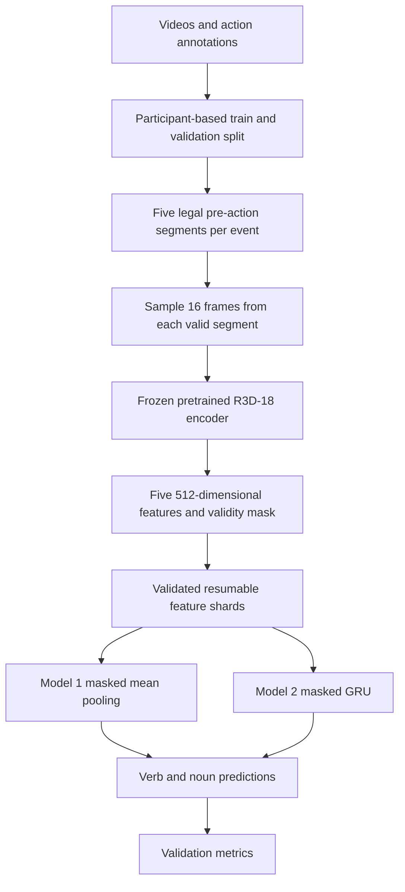

# Milestones 1–10 — Implementation and Presentation Notes

*Status recorded on 12 November 2026, based on the repository, notebooks, Git history, and VSC outputs shared in the project chat. Queue states and estimated start times below are historical observations.*

**We have built and tested the STA feature pipeline, completed a successful H100 smoke extraction, and submitted the full validation-feature extraction to A100.** The latest scheduler output shared at this point showed validation job **62663230 waiting for resources**. Full validation extraction and training-data extraction had not yet been demonstrated as completed.

The supplied document explicitly names Milestones 9 and 10. Milestones 1–8 below are reconstructed from the repository, notebooks, and Git history into a sequence that can be used for the presentation. Their descriptive titles are an explanatory reconstruction.

## 1. Establishing the project and understanding the dataset

We started by setting up a repository for two related tasks on EPIC-KITCHENS-100.

- **Action Recognition, AR** predicts an action while observing its annotated video interval.
- **Short-Term Action Anticipation, STA** predicts an upcoming action using the preceding context, ending one second before that action starts.

An action is represented by a **verb and a noun**. For example, “open drawer” combines the verb “open” with the noun “drawer.”

Our STA work therefore needs two outputs for each event:

```text
97 verb scores
300 noun scores
```

These are the fixed output dimensions. A particular annotation subset can contain fewer observed classes. The exploration notebook found 97 distinct verb labels and 289 distinct noun labels in the provided annotation CSV.

The initial exploration established the size and structure of our working annotation set:

| Property | Observed value |
|---|---:|
| Annotated action events | 67,217 |
| Participants | 32 |
| Referenced video IDs | 495 |
| Verb output classes | 97 |
| Noun output classes | 300 |

An **event** is one annotated action inside a video. A video can contain many events, so 67,217 events does not mean 67,217 video files.

Each annotation includes identifiers, timestamps, and labels. The fields we rely on include:

```text
narration_id
participant_id
video_id
start_timestamp
stop_timestamp
verb_class
noun_class
```

`narration_id` identifies an individual event. `video_id` identifies the recording containing that event.

We also inspected class-frequency plots. Some verbs and nouns occur much more often than others. This motivated both a frequency baseline and a metric that gives rare classes meaningful weight.

The repository separated reusable code, notebooks, scripts, raw data, processed metadata, and generated results. Videos, features, cached weights, and logs were excluded from Git so that commits capture the implementation and configuration.

**What this milestone established**

We understood what a prediction represents, how annotations connect to recordings, and which dataset statistics belong in later experiments.

## 2. Building reusable data utilities and a reproducible participant split

The initial notebook logic was moved into reusable data-processing functions.

These functions handle:

- Loading and validating annotation columns.
- Finding annotation CSVs.
- Indexing MP4 files recursively.
- Matching video IDs to paths.
- Converting timestamps into seconds.
- Reading RGB frames.
- Extracting preview clips.
- Creating and saving train/validation splits.

Video indexing uses the filename stem as the video ID and normalizes it to uppercase. This supports filenames such as `P01_03.mp4` and `P01_03.MP4`.

The indexer rejects duplicate video IDs because two different files mapping to the same ID would make extraction ambiguous.

For the split, we selected **participants**, rather than randomly selecting individual action rows.

The procedure was:

1. Collect and sort the unique participant IDs.
2. Shuffle them using NumPy with seed **42**.
3. Select approximately **20% of participants** for validation.
4. Assign every event from those participants to validation.
5. Assign the remaining participants’ events to training.
6. Check that the participant sets are disjoint.
7. Check that every original annotation is assigned exactly once.

The resulting split is:

| Split | Participants | Events |
|---|---:|---:|
| Training | 26 | 59,767 |
| Validation | 6 | 7,450 |
| Total | 32 | 67,217 |

The validation participants are:

```text
P08, P20, P21, P28, P29, P37
```

The 20% setting refers to **participants**. It does not force exactly 20% of action events into validation. Participants have different numbers of annotations, so validation contains approximately **11.1% of events**.

The split is saved as two CSV files. Later feature extraction and model evaluation use those same saved rows.

The original exploration also produced AR and STA preview clips for an example action. One notebook example had:

```text
Action interval       4.37–6.17 seconds
STA context interval  0.00–3.37 seconds
Anticipation gap      1.00 second
```

This let us visually inspect the difference between seeing an action and observing the context before it.

**Why this matters**

Separating participants makes validation evaluate generalization to people whose events were excluded from model fitting. Reusing the same split also makes model comparisons consistent.

The implementation is in [data_processing.py](../src/data_processing.py).

## 3. Defining the anticipation window and preventing future-frame leakage

For an action starting at time $t$, our STA input uses five seconds of context ending one second before the action.

The nominal observation interval is:

$$
[t-6,\;t-1)
$$

We divide this into five chronological segments:

| Segment | Interval |
|---|---|
| 0 | $[t-6,t-5)$ |
| 1 | $[t-5,t-4)$ |
| 2 | $[t-4,t-3)$ |
| 3 | $[t-3,t-2)$ |
| 4 | $[t-2,t-1)$ |

For an action starting at 20 seconds, the segments are:

```text
14–15 s
15–16 s
16–17 s
17–18 s
18–19 s
```

The target action starts at 20 seconds. The interval from 19 to 20 seconds is the anticipation gap.

The implementation requires every selected frame to satisfy:

$$
\text{frame time} < t-1
$$

This protects the task from future-frame leakage. If the model sees the target action or the forbidden gap, its measured anticipation performance would be misleading.

To select legal frames from a segment $[a,b)$, the sampler calculates:

```text
First legal frame index     ceil(a × FPS)
Exclusive upper frame index ceil(b × FPS)
```

It samples **16 frame indices** uniformly from that legal range.

When there are fewer than 16 available frame indices, some indices repeat. This preserves the input shape while keeping the selected frames inside the permitted interval.

The sampler also checks video length and verifies the resulting frame times.

The early development notebook sampled 16 frames across the entire observation window. The production feature extractor later adopted **16 frames per segment**, giving up to **80 sampled frame positions per event**.

**Handling actions near the beginning of a recording**

Some actions begin before five full seconds of preceding context exist.

We clamp segment boundaries at the start of the video and store a five-element Boolean mask. For an action at four seconds:

```text
Valid mask   [False, False, True, True, True]
```

The first two segments are unavailable. Their features are stored as exact zeros.

If the action begins at or before one second, no permitted observation interval exists. We retain that event with an all-false mask.

**Why this matters**

The temporal rules are encoded in the sampling functions and tested explicitly. They apply consistently during local development and cluster extraction.

## 4. Implementing Model 0 and the evaluation metrics

Before fitting a video model, we implemented a baseline called **Model 0**, the training-frequency prior.

It counts how often each verb and noun occurs in the training annotations and converts those counts into probabilities:

$$
P(v)=\frac{\text{training events with verb }v}
{\text{training events}}
$$

$$
P(n)=\frac{\text{training events with noun }n}
{\text{training events}}
$$

Every validation event receives the same verb and noun probability vectors.

This baseline establishes what can be achieved from label frequency alone. Its probabilities are estimated from the **training split**.

For action scores, the production evaluator combines the verb and noun probabilities:

$$
S(v,n)=P(v)P(n)
$$

The production implementation ranks **3,568 known verb–noun action pairs**, defined from the provided annotation set. The early exploratory notebook considered all $97 \times 300$ combinations. The production evaluator uses the known-pair mapping.

We implemented two types of metrics.

**Top-1 accuracy**

For each event, check whether the highest-scoring class is correct, then average over events.

**Class-mean Top-5 recall**

For each class, calculate the fraction of its events whose correct label appears among the five highest-scoring predictions. Then average those class recalls over classes represented in validation.

That gives each represented class equal weight, even if one class has many more events.

The H100 smoke job reproduced these baseline results:

| Metric | Verb | Noun | Action |
|---|---:|---:|---:|
| Top-1 accuracy | 19.56% | 5.72% | 0.00% |
| Class-mean Top-5 recall | 6.94% | 2.87% | 0.274% |

The printed action MT5R of approximately `0.0027` is a **fraction**, equivalent to approximately **0.27%**.

These are results for Model 0 on our participant-based validation split. They are the baseline against which the later video models will be compared.

Model 0 is also the intended fallback for events without usable video context. That fallback policy is documented, while its use inside the future complete trainer/evaluator still needs to be integrated.

The metric implementation is in [evaluation.py](../src/evaluation.py).

## 5. Agreeing on the feature format between extraction and modelling

Niels’s feature extraction and Emiel’s model development needed an explicit shared interface.

We defined a **versioned feature-shard contract**. A shard is a saved PyTorch dictionary holding features and metadata for several events.

For $N$ events, the central tensors are:

| Field | Shape | Stored type |
|---|---|---|
| Features | `[N, 5, 512]` | `float16` |
| Validity mask | `[N, 5]` | Boolean |
| Verb labels | `[N]` | `int64` |
| Noun labels | `[N]` | `int64` |
| Action-start timestamps | `[N]` | `float32` |
| Observation-cutoff timestamps | `[N]` | `float32` |

The dictionary also holds narration IDs, video IDs, split name, schema version, and an event status.

The feature shape means:

```text
N events
× 5 chronological video segments
× 512 numbers describing each segment
```

These 512 numbers are learned visual features. They are not verb or noun predictions.

We defined four statuses:

| Status | Meaning |
|---|---|
| `full` | All five segments are valid |
| `partial` | Between one and four segments are valid |
| `no_context` | No legal pre-action context exists |
| `video_error` | Reading or preparing the required video context failed |

Invalid segment features must be exactly zero. The mask tells downstream models which segments are usable.

To test the interface before full video extraction, we created a deterministic artificial shard with eight events. It includes full context, partial context, no context, and a video error.

This let the two development streams proceed independently. The models could consume realistic shapes and masks while the video extractor was being completed.

The shared validator checks dimensions, types, finite values, labels, IDs, mask/status consistency, zero padding, and timestamp constraints.

We store features in `float16` to reduce disk usage. The dataset loader converts each event’s features to `float32` when it is read for modelling.

The agreement is documented in the [feature-shard contract](sta_feature_shard_contract.md).

## 6. Implementing the frozen R3D-18 video encoder

We chose TorchVision’s pretrained **R3D-18** video network to turn each segment into a feature vector.

A 3D convolutional network processes spatial information and temporal changes across frames.

The implementation loads the pretrained weights and replaces the final classification layer with an identity layer. This exposes the **512-dimensional representation** before the original classifier.

We froze the encoder by:

- Setting it to evaluation mode.
- Disabling gradients on its parameters.
- Executing inference inside `torch.inference_mode()`.

The extraction jobs therefore apply an already trained visual encoder. They do not update its weights.

For each valid segment, the pipeline:

1. Reads 16 sampled frames using OpenCV.
2. Converts OpenCV’s BGR images to RGB.
3. Converts the frames to a PyTorch tensor.
4. Applies the preprocessing associated with the pretrained weights.
5. Runs the encoder.
6. Stores the resulting 512-dimensional feature vector.

The actual pretrained preprocessing currently used is:

```text
Resize frames to 128 × 171
Center crop to 112 × 112
Scale and normalize RGB values
Arrange the tensor for the video encoder
```

The normalization values come from the weights’ built-in transform.

This is an important detail for the presentation. The downloaded video collection is downscaled to approximately **640 × 360**, but the encoder receives **112 × 112 crops** after preprocessing.

A fully valid event becomes:

```text
Five video segments
→ five encoder outputs
→ one [5, 512] event feature tensor
```

For the cluster’s event batch size of eight, up to 40 valid segments are combined into an encoder batch.

The reason for caching these features is practical. Video decoding and R3D-18 inference are expensive. Once the features exist, different anticipation models can reuse them without repeatedly reading the original MP4s.

The implementation is in [sta_feature_extraction.py](../src/sta_feature_extraction.py).

## 7. Building batched extraction, resumable shards, and the dataset loader

We wrapped the frame sampler and encoder in a command-line extraction pipeline.

It accepts the selected split, video directory, output root, device, event batch size, decoder-worker count, shard size, and resume option.

Our full extraction configuration is:

```text
One GPU
Eight events per batch
Eight decoder workers
2,048 events per shard
float16 storage
Resume enabled
```

The eight decoder workers are CPU threads preparing video segments. They do not represent eight GPUs.

For each shard, the extractor:

1. Takes a consecutive block of annotation rows.
2. Processes those rows in smaller event batches.
3. Collects the features, masks, labels, and metadata.
4. Validates and saves the shard.
5. Records its range in a manifest.

The saved narration IDs follow the source CSV order.

**Why we use shards**

A shard groups many events into one file. This gives manageable storage units and limits the amount of work lost after an interrupted job.

For validation:

$$
7,450=3\times2,048+1,306
$$

Therefore, validation produces four shards.

For training:

$$
59,767=29\times2,048+375
$$

Therefore, training produces 30 shards.

One full shard’s feature tensor has shape:

```text
[2048, 5, 512]
```

Its feature values occupy approximately **10 MiB**, before metadata.

**Resume behavior**

With `--resume`, an existing shard is loaded and validated. Its narration IDs must match the expected source rows.

A matching valid shard is skipped. An unreadable or mismatched shard is rebuilt. Our updated resume check also retries shards containing `video_error`, allowing repaired video inputs to be processed again.

Each shard is written to a temporary file and renamed after saving succeeds. The manifest is also written through a temporary file.

The manifest records the shard index, filename, start row, exclusive end row, event count, split, and schema version.

**Dataset access**

`STAFeatureDataset` uses that manifest to provide event-level indexing. It loads the required shard and caches the most recently used one.

Each event returned to a model contains:

```text
float32 features shaped [5, 512]
Boolean mask shaped [5]
Labels
Narration and video IDs
Timestamps
Status
```

This separates model code from video decoding and shard-storage details.

The extraction entry point is [extract_sta_features.py](../scripts/extract_sta_features.py).

## 8. Testing the complete interface and integrating Models 1 and 2

We added several layers of checks before attempting full extraction.

**Artificial interface test**

The eight-event contract shard proved that the writer, loader, masks, labels, and model-facing shapes agreed.

**Real local video test**

An earlier local extraction selected the first eight training rows. Those rows referred to `P01_01`, which was unavailable in the local video subset. It produced one no-context event and seven video errors.

That identified a problem in how the development sample was selected.

We corrected the sample to use annotations for the available video **P01_03**.

The corrected saved shard was inspected and contains:

```text
8 events
Shape [8, 5, 512]
Stored dtype float16
8 full events
0 video errors
```

**Inspection and source-CSV verification**

The inspector checks the saved feature contract, including finite values and zero padding.

The additional verification command compares output narration IDs against the expected source-CSV slices, checks shard sizes and event statuses, and exercises float32 dataset reads.

These checks are complementary. A file can have valid tensor dimensions while representing the wrong source events.

**Parallel model development**

Emiel implemented two models against the shared feature interface.

| Model | Temporal aggregation | Outputs |
|---|---|---|
| Model 1 | Masked mean pooling | 97 verb logits and 300 noun logits |
| Model 2 | Masked GRU | 97 verb logits and 300 noun logits |

Model 1 averages only valid segment features:

$$
z=\frac{\sum_i m_i f_i}{\max(1,\sum_i m_i)}
$$

It applies dropout and separate linear verb and noun heads. Its default dropout is 0.3.

The pooling treats the five segment features as a set. Each segment feature itself still comes from a video encoder that processes temporal information inside that segment.

Model 2 processes the features chronologically with a GRU cell. Its default hidden dimension is 512.

For a valid segment, the candidate hidden state becomes the new state. For an invalid segment, the old hidden state is retained. This prevents padding from advancing the temporal representation.

The all-false mask produces a zero pooled representation in Model 1 and a zero hidden representation in Model 2. The documented training policy excludes such events from gradient updates and uses Model 0 for their final predictions.

**What the tests demonstrate**

The successful H100 smoke log contains **58 passing tests**:

| Test area | Tests |
|---|---:|
| Annotation and split audit | 6 |
| Evaluation and prior baseline | 3 |
| Inspection command | 1 |
| Feature dataset | 6 |
| Temporal sampling and extraction | 17 |
| Shard contract | 4 |
| Model 1 | 7 |
| Model 2 | 14 |
| **Total** | **58** |

The model tests cover output shapes, finite gradients, padding isolation, and empty-context behavior. Model 2 tests also verify that chronological order can affect its hidden representation.

This establishes that the model implementations and feature interface function together. Full model training and comparative video-model accuracy results are subsequent work.

## 9. Preparing VSC, resolving deployment problems, and passing the H100 smoke job

This milestone moved the pipeline from local development to an actual cluster GPU.

We created Slurm scripts with explicit resource requests and diagnostic logging.

| Resource | Smoke job |
|---|---|
| Cluster | wICE |
| Account | `lp_edu_rdlab` |
| GPU | One H100 for the successful smoke run |
| CPU cores | 12 |
| CPU memory | 96,000 MiB |
| Time limit | 15 minutes |
| Extraction sample | 64 training events |

The scripts print the hostname, Python executable, Git commit, GPU information, and extraction duration.

Several deployment problems were found and resolved.

**Missing annotation CSV**

The VSC checkout initially lacked the annotation file because raw data is ignored by Git.

We uploaded the CSV through Open OnDemand after an SSH file-transfer attempt timed out. We then regenerated the split CSVs using the same participant split and seed.

**Moving active video reads to scratch**

The complete video collection occupied approximately **48 GB**.

We staged the videos under:

```text
$VSC_SCRATCH/epic_sta/raw
```

The extraction commands explicitly read this directory through `--raw-dir`.

The persistent project location holds the repository, annotations, environment, logs, and generated feature shards. The storage cleanup retained `P01_03.mp4` in the repository’s raw directory because the real-video unit tests expect that fixture path.

**Correcting the context-count definitions**

The first audit failed because its hardcoded counts used a different definition of full context.

There are two meaningful statistics:

1. Events with five complete seconds of preceding context.
2. Events with all five segment-mask entries valid.

Our stored `full` status follows the second definition.

For an action starting at 5.5 seconds, the earliest segment is clipped to `[0, 0.5)`, but it still contains context. All five segments are valid.

The corrected status counts are:

| Split | Full masks | Partial masks | No context |
|---|---:|---:|---:|
| Training | 59,041 | 650 | 76 |
| Validation | 7,333 | 93 | 24 |

The earlier values of 58,895 train and 7,307 validation describe complete five-second windows. They should not be used as the expected `full` status totals.

The audit then passed against the scratch dataset. It checks annotation integrity, split integrity, context counts, and video-path coverage. Exhaustive decoding of every video occurs later as events are extracted.

**Resolving the CPU-only PyTorch installation**

The first H100 smoke attempt reached a node with an H100 but failed:

```text
AssertionError: CUDA is unavailable
```

Its job ID was **62663031**.

Diagnostics showed that Conda had selected CPU builds of PyTorch and TorchVision, despite the environment also containing CUDA runtime packages:

```text
Compiled CUDA version   None
CUDA support built      False
```

Trying to force the CUDA Conda builds then exposed incompatible FFmpeg requirements between OpenCV and TorchVision.

We changed the environment strategy to:

```text
Environment name   rd_epic_cuda
Python             3.11
PyTorch            2.5.1+cu118
TorchVision        0.20.1+cu118
OpenCV headless     4.10.0.84
NumPy              1.26.4
Pandas             2.2.3
```

Conda supplies Python and pip. Pip installs the explicit CUDA wheels and headless OpenCV.

**Resolving the storage quota failure**

The new installation initially failed with:

```text
Disk quota exceeded
```

The reported persistent-storage usage was **77,472 MiB against a 76,800 MiB quota**. Keeping the 48 GB video collection in both persistent storage and scratch contributed to that problem.

We established a cleanup procedure for duplicate persistent MP4s after comparing them against scratch, preserving the annotation CSV and test fixture. The later successful smoke log confirms that the CUDA environment installation was completed.

**Successful H100 execution**

The successful log reported:

```text
PyTorch             2.5.1+cu118
TorchVision         0.20.1+cu118
CUDA runtime        11.8
GPU                 NVIDIA H100 80GB HBM3
Compute capability  (9, 0)
Visible GPU memory  79.22 GiB
CUDA tensor check   2.0
```

It then completed:

1. All 58 unit tests.
2. Model 0 evaluation.
3. Extraction of 64 real events.
4. Inspection of the saved shard.
5. Comparison against the source CSV.
6. Float32 dataset-read checks.

The extraction results were:

| Check | Result |
|---|---:|
| Events | 64 |
| Shards | 1 |
| Full | 62 |
| Partial | 1 |
| No context | 1 |
| Video errors | 0 |
| Extraction duration | 48 seconds |

The log ended with:

```text
H100 smoke job passed.
```

The 48 seconds is the logged extraction duration. The unit tests and baseline evaluation ran separately before that timed extraction.

**What this milestone demonstrated**

The real video inputs, CUDA environment, pretrained encoder, storage format, verification tools, and dataset reader worked together on a cluster GPU.

## 10. Submitting full validation extraction and preparing the training-data job

After smoke passed, we moved to full extraction.

We chose **A100 for the large extraction jobs** because its credit rate is lower. We used H100 for smoke after checking scheduling estimates and seeing that it could start sooner.

The full A100 script requests:

```text
One A100
12 CPU cores
96,000 MiB CPU memory
12-hour time limit
Eight events per batch
Eight decoder workers
2,048 events per shard
float16 output
Resume enabled
```

It activates `rd_epic_cuda`, reads videos from scratch, and writes features to:

```text
$VSC_DATA/R-D_Group2/data/processed/sta_features
```

Its positional argument selects the source split:

```bash
sbatch slurm/sta_extract_a100.slurm validation
```

or:

```bash
sbatch slurm/sta_extract_a100.slurm train
```

The script is in [sta_extract_a100.slurm](../slurm/sta_extract_a100.slurm).

**Why validation goes first**

Validation is the smaller split, containing 7,450 events. It provides a full-split check on the A100 hardware before we process 59,767 training events.

After extraction, the same job runs the inspector and source-CSV verifier. A verification failure makes the job fail.

Validation extraction must produce:

```text
4 shards
7,450 events
7,333 full
93 partial
24 no_context
0 video_error
```

The four shard sizes are:

```text
2,048
2,048
2,048
1,306
```

These are groups of events, not groups of videos. One recording can contribute many events.

**Latest confirmed submission**

The A100 validation job is:

```text
Job ID       62663230
Partition    gpu_a100
State        PENDING
Reason       Resources
```

At the time of the 08:58 scheduler query, Slurm estimated a start at **13:41:02 on 12 November 2026**. That was a scheduling estimate, rather than a confirmed actual start.

**Training-data extraction**

Once processed, training should contain:

```text
30 shards
59,767 events
59,041 full
650 partial
76 no_context
0 video_error
```

The first 29 shards hold 2,048 events each. The final shard holds 375.

We discussed submitting this job early with:

```bash
--dependency=afterok:62663230
```

That dependency permits training-data extraction to start only after the validation job exits successfully, including its post-extraction checks.

No training job ID or submission output had been shared at this point, so its submission remains unconfirmed in this account.

**Estimating runtime**

After a complete A100 validation run, a first estimate for training extraction is:

$$
T_{\text{train}}
\approx T_{\text{validation}}\times
\frac{59,767}{7,450}
\approx T_{\text{validation}}\times8.02
$$

This estimate needs the A100 duration. The H100 smoke processed a small sample on different hardware and is insufficient for a reliable full-training estimate.

If a full extraction job times out, its completed shards can be reused on resubmission. Work within the unfinished shard must be repeated.

## How to explain the whole pipeline



The feature-generation path through the saved shards has been exercised successfully by the 64-event H100 smoke job. Models 1 and 2 are implemented and unit-tested. Their full training and performance comparison follow completion of the larger feature datasets.

The word **validation** has two uses in this project:

| Term | Meaning |
|---|---|
| Validation split | Held-out participant events used for later model evaluation |
| Feature validation | Checks that generated files, IDs, masks, and tensors are correct |
| Validation-feature extraction | Generating cached features for the held-out events |
| Model training | Updating the anticipation model’s parameters using training features |

The currently submitted extraction job generates features for the held-out events. It runs a frozen encoder and saves its outputs.

## A presentation-ready description of the current achievement

> We developed a reproducible short-term action anticipation pipeline for EPIC-KITCHENS. We split 67,217 annotated actions by participant, established a training-frequency baseline, and implemented strict temporal sampling so that inputs end one second before the target action. Each event is represented by five 512-dimensional features from a frozen pretrained R3D-18 encoder, together with a validity mask.
>
> We defined a shared shard format so feature extraction and model development could proceed in parallel. Masked mean-pooling and masked GRU models are implemented, and the full suite of 58 tests passed during a real H100 smoke job. That job extracted and verified 64 events in 48 seconds with zero video errors. We have now submitted full validation-feature extraction on A100. Completion of the validation and training feature sets will enable full model training and comparison.

For the results slides, the measured results available at this point are **Model 0’s validation metrics and the H100 smoke results**. The four validation shards and 30 training shards are expected full-extraction outputs until the corresponding successful job logs confirm them.
